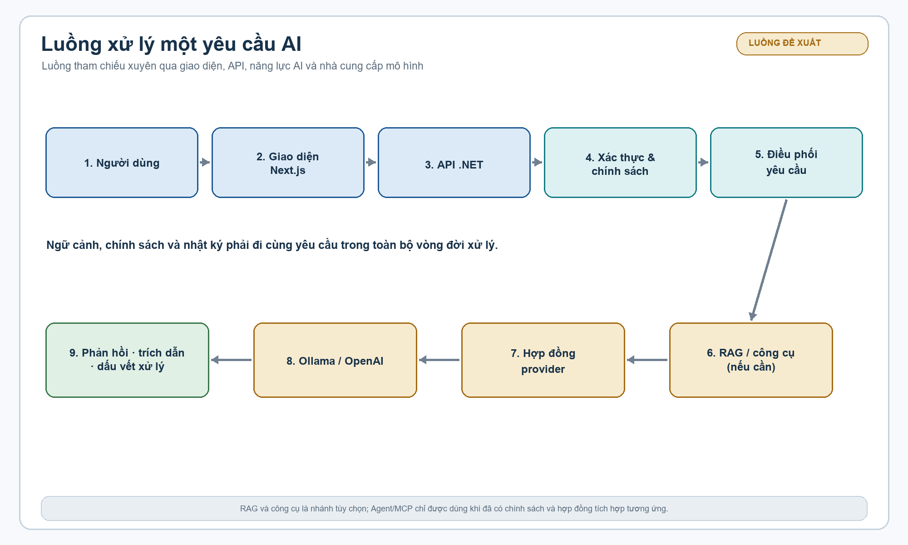

**HỌC VIỆN CÔNG NGHỆ BƯU CHÍNH VIỄN THÔNG**  
**VIỆN CÔNG NGHỆ THÔNG TIN VÀ TRUYỀN THÔNG**

# ĐỀ CƯƠNG ĐỀ ÁN TỐT NGHIỆP THẠC SĨ KỸ THUẬT

## NGHIÊN CỨU VÀ XÂY DỰNG NỀN TẢNG AI DOANH NGHIỆP HƯỚNG TÍCH HỢP ĐA HỆ THỐNG

**Tên tiếng Anh:** Enterprise AI Platform for Cross-System Integration  
**Học viên:** Nguyễn Tiến Đạt  
**Chuyên ngành:** Hệ thống Thông tin  
**Mã số:** 8.48.01.04  
**Người hướng dẫn:** PGS.TS. Trần Đình Quế  
**Loại đề tài:** Đề án theo hướng ứng dụng  
**Địa điểm, thời gian:** Hà Nội, 2026

---

## MỤC LỤC

1. [Tóm tắt đề tài](#tóm-tắt-đề-tài)
2. [I. Mở đầu](#i-mở-đầu)
3. [II. Nội dung](#ii-nội-dung)
   1. [Chương 1. Cơ sở lý luận và công nghệ nền tảng](#chương-1-cơ-sở-lý-luận-và-công-nghệ-nền-tảng)
   2. [Chương 2. Phân tích bài toán và thiết kế nền tảng](#chương-2-phân-tích-bài-toán-và-thiết-kế-nền-tảng)
   3. [Chương 3. Phương pháp thực hiện và hiện thực hóa prototype](#chương-3-phương-pháp-thực-hiện-và-hiện-thực-hóa-prototype)
   4. [Chương 4. Thực nghiệm, đánh giá và thảo luận](#chương-4-thực-nghiệm-đánh-giá-và-thảo-luận)
4. [III. Kết luận](#iii-kết-luận)
5. [IV. Danh mục tài liệu tham khảo](#iv-danh-mục-tài-liệu-tham-khảo)
6. [V. Dự kiến kế hoạch thực hiện](#v-dự-kiến-kế-hoạch-thực-hiện)
7. [Phụ lục](#phụ-lục)

---

# TÓM TẮT ĐỀ TÀI

Trong doanh nghiệp, dữ liệu phục vụ ra quyết định thường phân tán trong hệ thống quản lý tài liệu, cơ sở dữ liệu nghiệp vụ, phần mềm quản trị và các dịch vụ trực tuyến. Việc tìm kiếm thông tin vì vậy phụ thuộc nhiều vào từ khóa, cấu trúc thư mục và kinh nghiệm của người sử dụng. Các mô hình ngôn ngữ lớn có khả năng hiểu ngữ cảnh và sinh câu trả lời tự nhiên, nhưng nếu được sử dụng độc lập có thể trả lời thiếu căn cứ, khó kiểm soát quyền truy cập, phụ thuộc vào nhà cung cấp và không tạo ra được một quy trình tích hợp nhất quán.

Đề tài nghiên cứu và xây dựng một nền tảng AI doanh nghiệp theo hướng tích hợp đa hệ thống. Nền tảng được thiết kế theo kiến trúc phân lớp, trong đó các thành phần quản lý danh tính, tài liệu, lưu trữ, tìm kiếm ngữ nghĩa, RAG, bộ điều phối AI, công cụ nghiệp vụ và giao thức MCP được tổ chức thành các mô-đun có thể mở rộng. Thiết kế ưu tiên khả năng chạy cục bộ với Ollama, PostgreSQL và pgvector, đồng thời duy trì lớp trừu tượng để có thể kết nối thêm các nhà cung cấp mô hình khác.

Phạm vi prototype tập trung vào ba luồng sử dụng: quản lý và lập chỉ mục tài liệu; tìm kiếm ngữ nghĩa kết hợp hỏi đáp có trích dẫn; thử nghiệm điều phối tác vụ và gọi công cụ qua MCP. Mã nguồn hiện có thể hiện nhiều thành phần của kiến trúc mục tiêu ở mức khung hoặc prototype. Các kết quả định lượng chỉ được công bố sau khi hoàn thành build, triển khai, tạo bộ dữ liệu đánh giá và chạy thực nghiệm có thể lặp lại.

**Từ khóa:** Enterprise AI Platform, Large Language Model, RAG, Semantic Search, Hybrid Search, AI Agent, MCP, pgvector, Ollama, tích hợp hệ thống.

---

# I. MỞ ĐẦU

## 1. Lý do chọn đề tài

### 1.1. Bối cảnh ứng dụng AI trong doanh nghiệp

AI tạo sinh và mô hình ngôn ngữ lớn đang chuyển từ các ứng dụng hỏi đáp độc lập sang vai trò là một năng lực dùng chung trong doanh nghiệp. Một trợ lý AI có giá trị thực tế không chỉ cần sinh câu trả lời trôi chảy mà còn phải truy cập được nguồn tri thức được cấp quyền, hiểu được ngữ cảnh nghiệp vụ, ghi lại lịch sử xử lý và có khả năng kết nối đến những thao tác mà doanh nghiệp cho phép.

Trong thực tế, tri thức doanh nghiệp tồn tại ở nhiều dạng:

- văn bản, quy trình, quy chế, biểu mẫu và tài liệu hướng dẫn;
- dữ liệu có cấu trúc trong cơ sở dữ liệu nghiệp vụ;
- hệ thống ERP, CRM, DMS, HRM, cổng thông tin và phần mềm quy trình;
- API nội bộ, thư mục dùng chung, kho lưu trữ đối tượng và nhật ký vận hành.

Các nguồn này có định dạng, mô hình dữ liệu, cơ chế xác thực và chính sách phân quyền khác nhau. Nếu mỗi ứng dụng tự tích hợp một mô hình AI riêng, doanh nghiệp sẽ khó duy trì tính nhất quán, khó kiểm soát chi phí và khó đánh giá rủi ro.

### 1.2. Hạn chế của tìm kiếm truyền thống và chatbot độc lập

Tìm kiếm theo từ khóa hoạt động tốt khi người dùng biết chính xác thuật ngữ có trong tài liệu. Tuy nhiên, nó dễ bỏ sót các tài liệu diễn đạt cùng một ý bằng từ ngữ khác, đặc biệt khi người dùng đặt câu hỏi theo ngôn ngữ tự nhiên. Ở chiều ngược lại, chatbot dựa hoàn toàn vào LLM có thể tạo ra nội dung không xuất hiện trong nguồn dữ liệu, trộn lẫn các phiên bản tài liệu hoặc đưa ra câu trả lời vượt quá phạm vi quyền của người hỏi.

Retrieval-Augmented Generation giải quyết một phần vấn đề bằng cách đưa các đoạn văn bản liên quan vào ngữ cảnh trước khi mô hình sinh câu trả lời. Tuy nhiên, RAG chỉ đáng tin cậy khi toàn bộ vòng đời được thiết kế đồng bộ: trích xuất dữ liệu, làm sạch, chia đoạn, tạo embedding, lưu trữ, truy hồi, lắp ghép ngữ cảnh, sinh câu trả lời và tạo trích dẫn. Một pipeline thiếu kiểm soát ở bất kỳ khâu nào cũng làm giảm chất lượng đầu ra.

### 1.3. Nhu cầu về nền tảng mở và có thể kiểm soát

Đề tài lựa chọn cách tiếp cận nền tảng thay vì chỉ xây dựng một màn hình chatbot. Nền tảng cần đáp ứng các định hướng sau:

1. **Không phụ thuộc cứng vào một nhà cung cấp mô hình:** có thể chuyển giữa mô hình cục bộ và mô hình qua API.
2. **Ưu tiên dữ liệu nội bộ:** hỗ trợ triển khai tại chỗ hoặc trong mạng riêng khi dữ liệu không được gửi ra ngoài.
3. **Có căn cứ cho câu trả lời:** trả lại tài liệu, đoạn trích và thông tin nguồn để người dùng kiểm tra.
4. **Kiểm soát được thao tác:** phân biệt câu trả lời thông tin với hành động có tác động lên dữ liệu hoặc hệ thống.
5. **Có đường mở rộng:** bổ sung công cụ, connector, workflow và chính sách quản trị mà không phải viết lại toàn bộ ứng dụng.

## 2. Tổng quan vấn đề nghiên cứu

### 2.1. Các hướng công nghệ liên quan

Đề tài giao thoa giữa các hướng nghiên cứu và kỹ thuật sau:

| Hướng | Vai trò trong đề tài | Vấn đề cần giải quyết |
|---|---|---|
| Mô hình ngôn ngữ lớn | Hiểu yêu cầu, sinh câu trả lời, lập kế hoạch | độ tin cậy, chi phí, độ trễ và khác biệt năng lực giữa các provider |
| Embedding và vector search | Đo mức tương đồng ngữ nghĩa giữa truy vấn và tài liệu | chọn mô hình, chuẩn hóa chiều vector và tối ưu truy hồi |
| RAG | Gắn câu trả lời với tri thức nội bộ | chất lượng ingest, context assembly và citation |
| Hybrid search | Kết hợp từ khóa với ngữ nghĩa | hợp nhất thứ hạng và giảm bỏ sót thuật ngữ chuyên ngành |
| Agent và tool calling | Phân rã tác vụ, gọi công cụ được cho phép | ranh giới tự động hóa, phê duyệt và an toàn |
| MCP và connector | Chuẩn hóa việc cung cấp công cụ/ngữ cảnh cho AI | xác thực, schema, vòng đời và quyền truy cập |
| Quản trị AI | Theo dõi, audit, bảo vệ dữ liệu và người dùng | tenant isolation, prompt injection, rò rỉ dữ liệu và khả năng truy vết |

### 2.2. Khoảng trống cần nghiên cứu

Nhiều công trình mô tả riêng lẻ mô hình RAG, vector database, agent hoặc giao thức công cụ. Khoảng trống mà đề tài tập trung là cách tổ chức các thành phần đó thành một nền tảng có thể dùng trong môi trường doanh nghiệp, đồng thời phân biệt rõ ba lớp bằng chứng:

- **Thiết kế mục tiêu:** kiến trúc và các năng lực cần có khi hoàn thiện nền tảng.
- **Prototype trong mã nguồn:** các lớp, controller, service, giao diện và cấu hình đã được tạo.
- **Năng lực đã kiểm chứng:** thành phần đã build, chạy và có kết quả đo lặp lại.

Việc phân biệt này cần thiết vì một hệ thống có nhiều module trong source code chưa đồng nghĩa với một hệ thống đã vận hành ổn định. Đề tài do đó không chỉ trình bày kiến trúc mà còn xây dựng phương pháp đánh giá và kiểm tra tính nhất quán giữa kiến trúc, mã nguồn, cấu hình triển khai và kết quả thực thi.

## 3. Mục đích nghiên cứu

### 3.1. Mục đích tổng quát

Nghiên cứu cơ sở lý luận, đề xuất kiến trúc và xây dựng prototype cho một nền tảng AI doanh nghiệp hướng tích hợp đa hệ thống, có khả năng khai thác tri thức nội bộ bằng semantic search và RAG, đồng thời tạo nền tảng cho agent, tool calling và MCP.

### 3.2. Mục tiêu cụ thể

1. Hệ thống hóa các khái niệm và kỹ thuật liên quan đến LLM, embedding, vector search, RAG, hybrid search, agent, MCP và quản trị AI.
2. Phân tích yêu cầu của nền tảng AI dùng chung trong doanh nghiệp, bao gồm yêu cầu chức năng, phi chức năng, bảo mật và khả năng mở rộng.
3. Đề xuất kiến trúc bảy tầng theo hướng provider-agnostic, module hóa và có thể triển khai offline.
4. Xây dựng prototype bằng .NET 8, Next.js, PostgreSQL/pgvector, Redis, MinIO, Ollama và Docker Compose.
5. Hiện thực các vertical slice ưu tiên: xác thực, quản lý tài liệu, truy hồi ngữ nghĩa, RAG có trích dẫn, phiên hội thoại và khung điều phối công cụ.
6. Xây dựng giao thức thực nghiệm để đánh giá chất lượng truy hồi, chất lượng câu trả lời, độ chính xác trích dẫn, độ trễ, độ an toàn và mức độ sẵn sàng tích hợp.
7. Xác định các điểm chưa hoàn thiện của prototype và đề xuất lộ trình đưa nền tảng từ source skeleton đến hệ thống có thể kiểm chứng.

### 3.3. Câu hỏi nghiên cứu

- **RQ1:** Kiến trúc phân lớp nào giúp giảm phụ thuộc nhà cung cấp và vẫn hỗ trợ tiến hóa từ modular monolith lên các dịch vụ độc lập?
- **RQ2:** Việc kết hợp tìm kiếm từ khóa và tìm kiếm ngữ nghĩa ảnh hưởng như thế nào đến độ bao phủ và thứ hạng kết quả tài liệu nội bộ?
- **RQ3:** Những thành phần nào của pipeline RAG quyết định khả năng trả lời có căn cứ và trích dẫn đúng nguồn?
- **RQ4:** Cần đặt ranh giới và cơ chế phê duyệt nào khi AI chuyển từ trả lời thông tin sang gọi công cụ hoặc thực hiện hành động?
- **RQ5:** Làm thế nào để đánh giá một cách minh bạch sự khác nhau giữa kiến trúc mục tiêu, prototype trong source và runtime đã kiểm chứng?

## 4. Đối tượng và phạm vi nghiên cứu

### 4.1. Đối tượng nghiên cứu

Đối tượng của đề tài là kiến trúc, pipeline xử lý tri thức và các cơ chế tích hợp của nền tảng AI doanh nghiệp, trong đó tập trung vào:

- dữ liệu tài liệu và các đoạn văn bản đã được lập chỉ mục;
- truy hồi bằng embedding, từ khóa và chiến lược hybrid;
- sinh câu trả lời có ngữ cảnh và thông tin nguồn;
- bộ điều phối AI, công cụ được đăng ký và cơ chế phê duyệt;
- lớp trừu tượng provider và giao thức MCP;
- bảo mật, phân quyền, audit và khả năng triển khai trong mạng riêng.

### 4.2. Phạm vi chức năng

| Nhóm phạm vi | Nội dung |
|---|---|
| Quản lý người dùng | đăng ký, đăng nhập, refresh token, thông tin người dùng và vai trò cơ bản |
| Quản lý tài liệu | tải lên, lưu metadata, theo dõi trạng thái và lập chỉ mục ở mức prototype |
| Tìm kiếm | keyword, semantic, hybrid và gợi ý truy vấn ở mức thiết kế/prototype |
| Hỏi đáp | chat theo phiên, truy hồi ngữ cảnh, sinh câu trả lời, lưu lịch sử và citations |
| AI provider | lớp trừu tượng LLM/embedding, Ollama và provider API tùy cấu hình |
| Agent/tool | mô hình phiên agent, registry công cụ, SQL an toàn theo định hướng SELECT-only và phê duyệt |
| MCP | khung MCP server/client và cơ chế liệt kê/gọi công cụ ở mức prototype |
| Quản trị | dashboard, người dùng, tài liệu, provider, audit và health endpoint theo thiết kế |

### 4.3. Nội dung không thuộc phạm vi hiện tại

- Huấn luyện mới một mô hình ngôn ngữ lớn hoặc fine-tuning trên tập dữ liệu quy mô lớn.
- Thay thế các hệ thống ERP, CRM, DMS, HRM hoặc workflow hiện hữu.
- Cam kết tích hợp production với mọi hệ thống bên ngoài khi chưa có API, schema và dữ liệu kiểm thử tương ứng.
- Đưa ra kết quả định lượng về độ chính xác, độ trễ hoặc chi phí khi chưa chạy được pipeline hoàn chỉnh trên môi trường kiểm chứng.
- Xử lý giọng nói, SQL nghiệp vụ, workflow nhiều bước và multi-tenant production như các năng lực đã hoàn thiện; các nội dung này được mô tả trong kiến trúc mở rộng hoặc khung prototype.

## 5. Phương pháp nghiên cứu

### 5.1. Nghiên cứu tài liệu

Tổng hợp tài liệu về Transformer, LLM, dense retrieval, BM25, RRF, RAG, reranking, ReAct, Toolformer, MCP, microservices, NIST AI RMF, OWASP và pgvector. Kết quả được dùng để xây dựng mô hình khái niệm, tiêu chí thiết kế và bộ chỉ số đánh giá.

### 5.2. Phân tích và mô hình hóa hệ thống

Phân tích các tác nhân, use case, luồng dữ liệu, ranh giới tin cậy, mô hình lưu trữ và các điểm tích hợp. Kiến trúc được mô tả theo bảy tầng từ platform core đến presentation/API, kết hợp với các sơ đồ pipeline và deployment trong thư mục `references/figures/`.

### 5.3. Design science và vertical slice

Prototype được xây dựng theo từng lát cắt xuyên suốt: API, service, persistence, AI provider và giao diện. Mỗi lát cắt được đối chiếu với yêu cầu, cấu hình và kiểm tra tương ứng. Các lớp chưa đủ điều kiện chạy được ghi nhận là skeleton hoặc thiết kế mục tiêu, không coi là tính năng đã nghiệm thu.

### 5.4. Thực nghiệm có kiểm soát

Thực nghiệm dự kiến so sánh keyword search, semantic search, hybrid search và các cấu hình RAG khác nhau. Các biến độc lập gồm model/provider, số đoạn ngữ cảnh, ngưỡng tương đồng, chiến lược hợp nhất thứ hạng và có/không có reranker. Các chỉ số được thu thập trên cùng bộ câu hỏi, cùng corpus và cùng điều kiện chạy.

### 5.5. Kiểm chứng tái lập

Kiểm chứng gồm build source, kiểm tra cấu hình Docker, khởi động các dịch vụ, kiểm tra schema, chạy API smoke test, chạy frontend build và ghi lại phiên bản, cấu hình, log, thời gian, lỗi. Kết quả phải phân biệt rõ “pass”, “fail”, “chưa chạy” và “chưa có dữ liệu”.

## 6. Ý nghĩa khoa học và thực tiễn

### 6.1. Ý nghĩa khoa học

Đề tài hệ thống hóa mối quan hệ giữa RAG, hybrid search, agent, MCP và kiến trúc tích hợp doanh nghiệp. Điểm nhấn của nghiên cứu là mô hình hóa vòng đời từ dữ liệu đến câu trả lời hoặc hành động, thay vì đánh giá LLM như một thành phần sinh văn bản độc lập.

### 6.2. Ý nghĩa thực tiễn

Prototype cung cấp một nền tảng tham chiếu để doanh nghiệp thử nghiệm trợ lý AI trên dữ liệu nội bộ, ưu tiên triển khai tại chỗ và giảm phụ thuộc vào một API bên ngoài. Các tiêu chí an toàn, audit, phê duyệt và đánh giá được đưa vào từ đầu giúp hạn chế việc mở rộng tính năng AI trước khi kiểm soát được rủi ro.

---

# II. NỘI DUNG

# CHƯƠNG 1. CƠ SỞ LÝ LUẬN VÀ CÔNG NGHỆ NỀN TẢNG

## 1.1. Nền tảng AI doanh nghiệp

Nền tảng AI doanh nghiệp là một lớp năng lực dùng chung nằm giữa các ứng dụng nghiệp vụ, nguồn dữ liệu và các mô hình AI. Nền tảng không chỉ cung cấp một endpoint chat mà còn quản lý vòng đời yêu cầu, truy cập tri thức, định tuyến provider, gọi công cụ, chính sách bảo mật, quan sát hệ thống và lưu vết.

Một nền tảng phù hợp với môi trường doanh nghiệp cần tách các mối quan tâm sau:

1. **Platform core:** cấu hình, identity, tenant, policy, audit, cache và observability.
2. **Integration:** connector, message/event, API adapter và truy cập hệ thống ngoài.
3. **Provider abstraction:** interface chung cho LLM, embedding, speech và model metadata.
4. **AI engine core:** prompt, token, context, retrieval, reranking và response processing.
5. **Agent orchestration:** intent, planner, executor, memory, approval và workflow.
6. **AI gateway:** routing, fallback, health, quota, cost và latency policy.
7. **Presentation/API:** REST, streaming, authentication boundary, web UI và quản trị.

Định hướng triển khai ban đầu là modular monolith để giảm chi phí vận hành và giúp kiểm chứng end-to-end. Khi tải, quyền sở hữu dữ liệu hoặc yêu cầu phát hành độc lập tăng lên, từng mô-đun có thể được tách thành service.

## 1.2. Mô hình Transformer và mô hình ngôn ngữ lớn

Transformer sử dụng cơ chế self-attention để biểu diễn quan hệ giữa các token trong một chuỗi. Trong ứng dụng của đề tài, LLM đảm nhiệm các tác vụ như hiểu yêu cầu, tóm tắt ngữ cảnh, sinh câu trả lời, phân loại ý định và đề xuất lời gọi công cụ.

LLM không phải nguồn sự thật tuyệt đối. Đầu ra phụ thuộc vào model, prompt, ngữ cảnh, sampling, giới hạn token và dữ liệu huấn luyện. Vì vậy hệ thống cần:

- quy định rõ nguồn dữ liệu được phép sử dụng;
- đưa ngữ cảnh truy hồi vào prompt một cách có cấu trúc;
- hướng dẫn mô hình từ chối khi không đủ bằng chứng;
- kiểm tra đầu ra, citations và thao tác công cụ;
- lưu model, tham số và thời gian xử lý để có thể truy vết.

## 1.3. Embedding và tìm kiếm vector

Embedding ánh xạ văn bản vào một không gian vector nhiều chiều. Hai văn bản có nội dung gần nhau thường có vector gần nhau theo một độ đo như cosine similarity. Với corpus tài liệu, mỗi chunk được lưu cùng embedding; truy vấn người dùng cũng được embedding rồi dùng để tìm các chunk gần nhất.

Các yếu tố ảnh hưởng trực tiếp đến chất lượng vector search gồm:

- mô hình embedding và ngôn ngữ hỗ trợ;
- cách làm sạch, chia đoạn và giữ metadata;
- chiều vector phải thống nhất giữa model, schema và index;
- bộ lọc quyền truy cập phải được áp dụng trước hoặc trong truy hồi;
- ngưỡng similarity, số lượng candidate và chiến lược rerank.

Prototype hiện định hướng sử dụng `nomic-embed-text` qua Ollama với vector 768 chiều ở các lớp dữ liệu .NET. Trong khi đó, script `docker/init.sql` hiện khai báo `VECTOR(1536)` theo ghi chú cho OpenAI embedding. Đây là một bất nhất triển khai phải được chuẩn hóa trước khi chạy ingest và search; không được xem là chi tiết có thể bỏ qua vì phép tính khoảng cách yêu cầu cùng chiều vector.

## 1.4. RAG: Retrieval-Augmented Generation

RAG gồm hai giai đoạn chính.

### 1.4.1. Ingestion

```text
Tệp tài liệu
  1. Kiểm tra loại và kích thước
  2. Lưu object và metadata
  3. Trích xuất văn bản
  4. Làm sạch và chuẩn hóa
  5. Chia thành các chunk có overlap
  6. Tạo embedding
  7. Lưu chunk, metadata và vector
  8. Cập nhật trạng thái, log và thông báo
```

Chunk cần giữ được thông tin nguồn như document id, tiêu đề, số trang, vị trí, phiên bản, quyền truy cập và content hash. Chunk quá ngắn làm mất ngữ cảnh; chunk quá dài làm giảm độ chính xác truy hồi và tăng chi phí context.

### 1.4.2. Query

```text
Câu hỏi
  1. Xác thực người dùng và tenant
  2. Phân tích câu hỏi và bộ lọc
  3. Tạo query embedding
  4. Truy hồi candidate
  5. Lọc quyền và rerank
  6. Lắp ghép context có giới hạn
  7. Sinh câu trả lời
  8. Kiểm tra citations và định dạng
  9. Lưu lịch sử, metrics và audit
```

RAG nên chỉ sử dụng các đoạn đã truy hồi để trả lời câu hỏi thuộc corpus. Với câu hỏi không có bằng chứng, hệ thống cần trả lời theo hướng nêu rõ không tìm thấy thông tin phù hợp thay vì bịa nội dung.

## 1.5. Hybrid search, RRF và reranking

Keyword search có ưu thế với mã số, tên riêng, thuật ngữ và cụm từ chính xác. Dense search có ưu thế với cách diễn đạt tương đương về mặt ngữ nghĩa. Hybrid search kết hợp hai danh sách kết quả.

Một cách hợp nhất phổ biến là Reciprocal Rank Fusion:

\[
RRF(d) = \sum_{r \in \{keyword, vector\}} \frac{w_r}{k + rank_r(d)}
\]

Trong đó `w_r` là trọng số của nguồn kết quả, `rank_r(d)` là thứ hạng của tài liệu `d`, và `k` là hằng số ổn định. Sau bước hợp nhất có thể dùng reranker để đánh giá lại cặp truy vấn–đoạn văn bản. Prototype đặt định hướng trọng số vector `0.7` và keyword `0.3`; đây là giá trị cấu hình ban đầu cần được kiểm chứng trên dữ liệu thực tế.

## 1.6. Agent, ReAct và tool calling

Agent mở rộng chatbot bằng cách cho phép hệ thống nhận diện ý định, lập kế hoạch, chọn công cụ, thực thi, quan sát kết quả và tiếp tục hoặc dừng. Mô hình ReAct gợi ý cách đan xen suy luận với hành động, nhưng trong hệ thống thực tế phần suy luận nội bộ không nên được coi là bằng chứng cho phép thực hiện hành động.

Tool calling cần có:

- schema đầu vào và đầu ra rõ ràng;
- danh mục công cụ và capability;
- kiểm tra người dùng, tenant và phạm vi dữ liệu;
- giới hạn số bước, timeout, retry và ngân sách;
- phân loại read-only hoặc side effect;
- yêu cầu phê duyệt cho hành động rủi ro;
- log đầy đủ request, tool, kết quả, người phê duyệt và trạng thái.

Trong prototype, registry có các nhóm công cụ tìm kiếm, truy vấn RAG, truy vấn SQL, gọi API, lấy context và sinh phản hồi. SQL và API caller được định hướng yêu cầu approval; việc này cần được kiểm tra bằng test negative trước khi coi là an toàn.

## 1.7. Model Context Protocol

MCP cung cấp một giao diện có cấu trúc để client khám phá và gọi tool hoặc nhận context từ server. Trong nền tảng, MCP có thể trở thành lớp chuẩn hóa giữa agent và các hệ thống ngoài, giúp giảm việc viết adapter riêng cho từng model.

MCP không tự giải quyết các vấn đề về danh tính và phân quyền. Mỗi lời gọi vẫn phải mang theo hoặc liên kết được với principal, tenant, policy và correlation id. Server không được coi thông tin do model tạo ra là quyền hạn của người dùng.

## 1.8. Bảo mật, quản trị và an toàn AI

Các lớp kiểm soát cần được xem xét đồng thời:

1. xác thực và quản lý vòng đời token;
2. RBAC/ABAC theo người dùng, phòng ban, tenant và tài liệu;
3. tenant isolation trong truy vấn, cache, object storage và log;
4. mã hóa dữ liệu truyền và dữ liệu lưu trữ;
5. chống prompt injection, data exfiltration và tool abuse;
6. kiểm soát SQL, API và side effect;
7. audit, giám sát, cảnh báo và quy trình phản hồi sự cố;
8. human-in-the-loop cho hành động có rủi ro.

Nguyên tắc quan trọng là quyền của AI không được rộng hơn quyền của người dùng đang yêu cầu. RAG cũng không được dùng để vượt qua bộ lọc quyền bằng cách lấy trước toàn bộ corpus rồi mới lọc ở giao diện.

## 1.9. Chỉ số đánh giá

### 1.9.1. Đánh giá truy hồi

- `Recall@k`: tỷ lệ tài liệu hoặc chunk liên quan xuất hiện trong top-k.
- `Precision@k`: tỷ lệ kết quả top-k là liên quan.
- `MRR`: đánh giá vị trí của kết quả đúng đầu tiên.
- `nDCG@k`: đánh giá thứ hạng với mức độ liên quan khác nhau.
- tỷ lệ truy vấn không có kết quả phù hợp.

### 1.9.2. Đánh giá câu trả lời

- groundedness/faithfulness: câu trả lời có được hỗ trợ bởi context hay không;
- answer relevance: câu trả lời có đáp ứng câu hỏi hay không;
- citation precision và citation recall;
- tỷ lệ trả lời đúng, đúng một phần và từ chối đúng khi thiếu bằng chứng;
- tỷ lệ hallucination qua đánh giá của người và/hoặc bộ đánh giá tự động có kiểm soát.

### 1.9.3. Đánh giá vận hành và an toàn

- thời gian truy hồi, thời gian sinh và end-to-end latency;
- p50, p95, p99, throughput và tỷ lệ lỗi;
- số token, chi phí, tỷ lệ cache hit;
- tỷ lệ request bị chặn đúng policy;
- tỷ lệ rò rỉ chéo tenant trong tập kiểm thử phân quyền;
- tỷ lệ công cụ yêu cầu approval và tỷ lệ từ chối đúng.

## 1.10. Nhận xét các hướng tiếp cận liên quan

Các nghiên cứu về DPR, Sentence-BERT, BM25, RRF và HNSW cung cấp nền tảng cho truy hồi. Các nghiên cứu về RAG cho thấy việc kết hợp bộ nhớ ngoài với LLM giúp cập nhật tri thức mà không phải huấn luyện lại mô hình. ReAct và Toolformer gợi ý khả năng sử dụng công cụ. MCP cung cấp một hướng giao thức hóa kết nối context/tool.

Tuy nhiên, các kỹ thuật riêng lẻ chưa đủ để tạo thành hệ thống doanh nghiệp. Đề tài bổ sung góc nhìn vòng đời, kiến trúc, bảo mật, khả năng vận hành và kiểm chứng runtime. Khoảng cách giữa “có lớp code” và “có tính năng vận hành” được đưa vào như một phần của phương pháp nghiên cứu.

### Kết luận chương 1

Chương 1 đã xác lập nền tảng lý luận cho nền tảng AI doanh nghiệp: provider abstraction, embedding, RAG, hybrid retrieval, agent, MCP và governance. Đây là cơ sở để phân tích yêu cầu, chọn kiến trúc và xây dựng giao thức thực nghiệm ở các chương sau.

---

# CHƯƠNG 2. PHÂN TÍCH BÀI TOÁN VÀ THIẾT KẾ NỀN TẢNG

## 2.1. Phân tích bài toán hiện tại

Bài toán được mô hình hóa từ một kho tài liệu nội bộ và mở rộng thành nền tảng AI có khả năng kết nối nhiều nguồn. Người dùng cần tìm tài liệu bằng câu hỏi tự nhiên, nhận câu trả lời có căn cứ và tiếp tục thực hiện các thao tác được cấp quyền. Quản trị viên cần biết dữ liệu nào đã lập chỉ mục, provider nào đang hoạt động, request nào đã được xử lý và hành động nào đã được phê duyệt.

Các điểm khó chính:

1. Dữ liệu không đồng nhất về định dạng và chất lượng.
2. Từ khóa không phản ánh đầy đủ ý định người dùng.
3. Embedding, schema và index phải nhất quán.
4. Câu trả lời cần liên kết với nguồn, phiên bản và quyền truy cập.
5. Provider có model, API, giới hạn token và chi phí khác nhau.
6. Agent có thể tạo side effect nên không thể cho chạy tự do.
7. Hệ thống phải quan sát được và có thể điều tra khi có lỗi.

## 2.2. Tác nhân và nhóm sử dụng

| Tác nhân | Nhu cầu chính | Quyền dự kiến |
|---|---|---|
| Nhân viên/người dùng | tìm kiếm, hỏi đáp, xem lịch sử | tài liệu và công cụ thuộc phạm vi được cấp |
| Người quản lý nội dung | tải lên, phân loại, theo dõi lập chỉ mục | tài liệu thuộc đơn vị hoặc kho được phân công |
| Quản trị viên | người dùng, provider, audit, health, thống kê | quản trị toàn hệ thống theo policy |
| Hệ thống tích hợp | cung cấp dữ liệu hoặc nhận kết quả qua API/MCP | service identity, scope và rate limit riêng |
| Người phê duyệt | xem và chấp thuận hành động nhạy cảm | quyền approval độc lập với quyền yêu cầu |

## 2.3. Yêu cầu chức năng

### 2.3.1. Nhóm ưu tiên cho vertical slice

| Mã | Yêu cầu | Tiêu chí kiểm tra |
|---|---|---|
| F01 | đăng ký, đăng nhập, refresh và logout | token hợp lệ; request không có quyền bị từ chối |
| F02 | tải tài liệu và lưu metadata | kiểm tra extension, kích thước, hash và trạng thái |
| F03 | lập chỉ mục tài liệu | có text/chunk/embedding; lỗi được ghi nhận và có trạng thái |
| F04 | semantic search | truy hồi theo similarity với bộ lọc quyền |
| F05 | hybrid search | kết hợp keyword và vector, có thứ hạng ổn định |
| F06 | hỏi đáp RAG | câu trả lời có context và citations khi có bằng chứng |
| F07 | quản lý session/chat | tạo, đọc, xóa session và lưu message |
| F08 | kiểm tra health và model | hiển thị trạng thái provider và hạ tầng |

### 2.3.2. Nhóm mở rộng

| Mã | Yêu cầu | Điều kiện mở rộng |
|---|---|---|
| F09 | agent nhiều bước | intent, plan, executor, memory, giới hạn bước |
| F10 | tool registry | schema, capability, policy và audit |
| F11 | MCP server/client | khám phá và gọi tool qua giao thức có cấu trúc |
| F12 | SQL tự nhiên | chỉ cho phép truy vấn an toàn, schema allowlist và approval |
| F13 | voice | STT/TTS cục bộ hoặc qua provider tùy cấu hình |
| F14 | connector doanh nghiệp | ERP, CRM, DMS, HRM, workflow hoặc API cụ thể |
| F15 | multi-tenant production | RLS, tenant-aware cache/object/audit và kiểm thử cô lập |

## 2.4. Yêu cầu phi chức năng và mục tiêu thiết kế

Các con số trong bảng là mục tiêu cần đo, không phải kết quả đã đạt của prototype.

| Nhóm | Mục tiêu đề xuất | Cách kiểm chứng |
|---|---|---|
| Chất lượng tìm kiếm | tăng khả năng tìm đúng tài liệu, theo dõi Recall@k, MRR và nDCG | tập truy vấn có nhãn liên quan |
| Chất lượng RAG | câu trả lời có căn cứ, citations đúng và từ chối khi thiếu bằng chứng | bộ câu hỏi có đáp án/nguồn chuẩn và đánh giá viên |
| Độ trễ | theo dõi search p50/p95, chat p50/p95 và từng chặng pipeline | log có correlation id và timestamp |
| Khả năng sẵn sàng | health check rõ ràng cho API, database, Redis, object storage, LLM | smoke test và khởi động lại dịch vụ |
| Bảo mật | không truy cập chéo user/tenant; tool nhạy cảm phải approval | bộ test negative và audit log |
| Mở rộng | thêm provider/tool mà không sửa business flow cốt lõi | contract test và integration test |
| Tái lập | cùng corpus/config cho kết quả có thể so sánh | lưu manifest dữ liệu và cấu hình |

## 2.5. Kiến trúc bảy tầng

Kiến trúc mục tiêu được tổ chức theo thứ tự từ nền tảng lên giao diện:

| Tầng | Thành phần | Trách nhiệm |
|---:|---|---|
| 1 | Platform Core | identity, tenant, policy, audit, cache, observability, cấu hình |
| 2 | Integration Layer | connector, API adapter, event/message và truy cập nguồn ngoài |
| 3 | Provider Abstraction | interface chung cho LLM, embedding, speech và model metadata |
| 4 | AI Engine Core | prompt, token, context, retrieval, rerank, response processing |
| 5 | Agent & Workflow | intent, planner, executor, memory, approval và workflow |
| 6 | AI Gateway | routing, fallback, health, quota, cost và latency policy |
| 7 | Presentation/API | REST, streaming, authentication boundary, web UI, admin |


*Hình 2.1. Kiến trúc tổng thể bảy tầng của nền tảng.*

Thiết kế tránh để controller gọi trực tiếp một SDK model hoặc một database cụ thể. Các interface ở tầng provider và gateway cho phép thay đổi model; các service ở tầng AI engine giữ logic nghiệp vụ; presentation chỉ chịu trách nhiệm giao tiếp với client.

## 2.6. Ranh giới thiết kế và ánh xạ với source

| Năng lực | Thành phần dự kiến trong source | Mức diễn giải trong báo cáo |
|---|---|---|
| API | `Controllers/`, `Program.cs` | có route/controller trong source; runtime cần build và smoke test |
| LLM/embedding | `AI/Providers/` | abstraction và Ollama/OpenAI provider ở mức prototype |
| Gateway | `AI/Gateway/` | thiết kế routing/fallback; cần sửa lỗi cú pháp trước khi build |
| RAG | `AI/RAG/`, `Services/Implementations/ChatService.cs` | có hai hướng triển khai, cần hợp nhất contract và DbContext |
| Search | `AI/Search/`, `Services/Implementations/SearchService.cs` | có skeleton semantic/hybrid; cần kiểm chứng ranking thực tế |
| Agent/tool | `AI/Agent/`, `AI/Tools/` | khung điều phối và registry, chưa coi là agent production |
| MCP | `AI/MCP/` | server/client WebSocket ở mức prototype |
| Dữ liệu | `Infrastructure/Data/`, `Infrastructure/AI/` | đang tồn tại hai hướng model/context và cần chuẩn hóa |
| Giao diện | `src/frontend/app/`, `components/` | có các màn hình auth, tài liệu, search, chat, agent, admin |
| Hạ tầng | `docker/docker-compose.yml`, `docker/init.sql` | cấu hình Compose parse được; runtime cần kiểm thử từng service |

## 2.7. Thiết kế dữ liệu và lưu trữ

### 2.7.1. Các thực thể logic

Mô hình logic gồm các nhóm chính:

- `Users`, `RefreshTokens`: danh tính và phiên xác thực;
- `Tenants`, `TenantAIConfigs`: cấu hình phân vùng và provider theo tenant trong thiết kế mở rộng;
- `DocumentCategories`, `Documents`: metadata, phân loại, trạng thái, người tải lên;
- `DocumentChunks`: nội dung chunk, hash, metadata và vector;
- `ChatSessions`, `ChatMessages`: hội thoại và nguồn được sử dụng;
- `SearchLogs`/`SearchAnalytics`: truy vấn, loại tìm kiếm, thời gian và kết quả;
- `AuditLogs`: hành động, chủ thể, entity, địa chỉ và chi tiết;
- `SystemSettings`: cấu hình hệ thống.

### 2.7.2. Công nghệ lưu trữ

| Thành phần | Vai trò |
|---|---|
| PostgreSQL 16 | dữ liệu giao dịch, metadata, user, session, audit |
| pgvector | lưu và truy hồi embedding |
| Redis | cache, session/agent memory và dữ liệu tạm |
| MinIO | object storage cho file gốc |
| Seq/Serilog | log tập trung và quan sát prototype |

### 2.7.3. Quyết định cần chuẩn hóa

Source .NET sử dụng `AIDbContext` trong một số module và `AppDbContext` trong các service khác; hai context đi kèm các bộ entity khác nhau. Ngoài ra, source local embedding định hướng 768 chiều trong khi `docker/init.sql` khai báo 1536 chiều. Trước khi kiểm thử end-to-end cần chọn một schema chuẩn, một context chuẩn và một embedding dimension; migration/schema, code, index và dữ liệu seed phải cùng sử dụng lựa chọn đó.

## 2.8. Thiết kế pipeline tài liệu


*Hình 2.2. Pipeline từ tài liệu gốc đến dữ liệu có thể truy hồi.*

### 2.8.1. Tiếp nhận và lưu file

API nhận `multipart/form-data`, kiểm tra extension và kích thước, tính hash để phát hiện trùng lặp, lưu file vào MinIO và tạo bản ghi `Documents`. Tên object phải được tạo một lần và sử dụng nhất quán khi upload, download, presigned URL và delete.

### 2.8.2. Trích xuất, làm sạch và chia đoạn

Pipeline mục tiêu cần có bộ xử lý riêng cho PDF, DOCX, TXT/Markdown và bảng tính. Metadata trang, tiêu đề, heading, bảng và vị trí trong tài liệu cần được giữ lại nếu muốn citations có giá trị. Chunking phải xác định rõ đơn vị token hoặc ký tự, kích thước, overlap và cách xử lý đoạn quá dài.

### 2.8.3. Embedding và index

Mỗi chunk được embedding theo cùng model và được lưu cùng dimension. Nếu đổi provider/model, cần version hóa embedding để không trộn vector không tương thích trong cùng index. Index HNSW cần được tạo sau khi schema dimension đã chốt.

### 2.8.4. Trạng thái và lỗi

Một tài liệu cần có các trạng thái tối thiểu `draft`, `processing`, `indexed`, `failed` và `archived` hoặc tương đương. Lỗi từng bước cần có mã, thông tin ngắn gọn cho người dùng và chi tiết trong log; retry phải có giới hạn và không tạo duplicate chunk.

## 2.9. Thiết kế semantic search và RAG



*Hình 2.3. Luồng một yêu cầu từ API đến provider và phản hồi.*

### 2.9.1. Truy hồi

Query được kiểm tra quyền và phân tích bộ lọc trước khi tạo embedding. Vector store truy hồi candidate theo cosine distance. Keyword search bổ sung các match theo nội dung. Hai danh sách được hợp nhất theo RRF hoặc một chiến lược được cấu hình; sau đó áp dụng ngưỡng relevance và giới hạn số chunk.

### 2.9.2. Context assembly

Context được xây dựng từ các chunk đã lọc, kèm tiêu đề, số thứ tự, document id, vị trí và điểm liên quan. Prompt phải phân tách rõ chỉ dẫn của hệ thống, câu hỏi của người dùng và dữ liệu trích xuất. Nội dung tài liệu được coi là dữ liệu không đáng tin cậy đối với instruction, nhằm giảm prompt injection từ chính corpus.

### 2.9.3. Câu trả lời và citations

Mô hình được yêu cầu trả lời dựa trên context, sử dụng marker citation theo tài liệu/đoạn và nêu rõ khi không có bằng chứng. Hậu xử lý kiểm tra citation có trỏ tới nguồn đã truy hồi hay không. Citation hiển thị cho người dùng phải có đủ metadata để mở hoặc xác định tài liệu.

## 2.10. Provider abstraction và AI Gateway

Provider abstraction định nghĩa các hợp đồng tối thiểu cho LLM, streaming, embedding, model information và health. Ollama được sử dụng cho triển khai local; OpenAI provider là một lựa chọn cấu hình. Gateway chịu trách nhiệm:

- chọn provider theo chiến lược cụ thể, chi phí, độ trễ hoặc fallback;
- kiểm tra health và danh sách model;
- thống nhất request/response giữa các provider;
- ghi nhận model, token, latency và lỗi;
- tránh dùng cloud provider khi policy yêu cầu offline.

Gateway không được che giấu khác biệt quan trọng giữa model. Capability, context window, tool calling, streaming, embedding dimension và cost phải được biểu diễn trong metadata để tầng agent và RAG ra quyết định đúng.

## 2.11. Agent, tool và MCP

### 2.11.1. Agent lifecycle

```text
Nhận yêu cầu
  1. Xác thực và nạp policy
  2. Phân loại intent
  3. Lập plan hoặc chọn direct answer
  4. Chọn tool phù hợp
  5. Kiểm tra quyền và approval
  6. Thực thi trong giới hạn
  7. Đánh giá kết quả
  8. Trả lời, lưu memory và audit
```

### 2.11.2. Phân loại công cụ

| Loại | Ví dụ | Chính sách mặc định |
|---|---|---|
| Read-only knowledge | search, RAG query, context retriever | cho phép nếu vượt qua quyền dữ liệu |
| Read-only business | schema hoặc SQL SELECT đã giới hạn | allowlist, giới hạn hàng và có thể yêu cầu approval |
| External API | gọi API hệ thống khác | scope, timeout, rate limit và approval tùy rủi ro |
| Side-effect | cập nhật, gửi, xóa, chuyển trạng thái | luôn cần approval hoặc workflow rõ ràng |

### 2.11.3. MCP boundary

MCP server công bố tool và nhận request gọi tool. MCP client giúp agent dùng nguồn tool bên ngoài. Tại boundary này cần kiểm tra origin, transport, authentication, schema validation, timeout, rate limit và correlation id. Không nên mở MCP server ra mạng ngoài nếu chưa có lớp xác thực và policy tương ứng.

## 2.12. Bảo mật và quản trị


*Hình 2.4. Các lớp bảo vệ dự kiến cho nền tảng.*

Mô hình bảo vệ gồm identity, authorization, data isolation, input/output guard, tool policy, audit và observability. JWT chỉ là cơ chế mang danh tính; hệ thống vẫn phải kiểm tra quyền ở service/repository và không dựa vào việc ẩn dữ liệu ở frontend.

Prototype cần tiến tới các kiểm soát sau:

- password policy, rate limit, token rotation và xử lý secret ngoài source;
- policy theo role, department, tenant và document ACL;
- query filter bắt buộc theo tenant/user ở mọi repository;
- cache key chứa tenant/user khi dữ liệu không công khai;
- không ghi prompt, tài liệu nhạy cảm hoặc token vào log không kiểm soát;
- audit tool call, approval, export và thay đổi cấu hình;
- CORS, CSRF, security headers và giới hạn kích thước request ở môi trường triển khai.

## 2.13. API, giao diện và triển khai

### 2.13.1. API dự kiến

| Nhóm | Route chính trong source |
|---|---|
| Auth | `/api/v1/auth` |
| Documents | `/api/v1/documents` |
| Chat | `/api/v1/chat` |
| Search | `/api/v1/search` |
| AI | `/api/v1/ai` |
| RAG | `/api/v1/rag` |
| Agent | `/api/v1/agent` |
| SQL | `/api/v1/sql` |
| Voice | `/api/v1/voice` |
| Admin | `/api/v1/admin` |

Source hiện có hai controller cùng khai báo route `/api/v1/search`; đây là điểm phải hợp nhất trước khi kiểm thử API. Health check trong Compose đang gọi `/api/health`, trong khi `Program.cs` hiện map `/health`; hai bên cần thống nhất contract.

### 2.13.2. Giao diện web

Frontend Next.js có các vùng login/register, dashboard, documents, upload, search, chat/history, agent và admin. UI cần hiển thị trạng thái indexing, nguồn citation, approval pending, lỗi provider và quyền truy cập một cách rõ ràng; không nên chỉ hiển thị câu trả lời cuối cùng.

### 2.13.3. Hạ tầng local

Docker Compose định nghĩa Ollama, PostgreSQL/pgvector, Redis, MinIO, backend, frontend và Seq. Mô hình này phù hợp cho môi trường nghiên cứu và demo trong mạng riêng. Khi chuyển production cần thay image `latest`, đặt secret qua secret manager, cấu hình volume/backup, network policy, health/readiness probe và giới hạn tài nguyên.

## 2.14. Các quyết định thiết kế và đánh đổi

| Quyết định | Lợi ích | Đánh đổi hoặc điều kiện |
|---|---|---|
| Modular monolith trước | dễ debug và kiểm thử end-to-end | cần kỷ luật boundary để không thành code phụ thuộc chéo |
| Ollama local | riêng tư, offline, chi phí API thấp | model/hardware giới hạn, cần theo dõi độ trễ |
| PostgreSQL + pgvector | giảm số hệ thống, giao dịch và vector gần nhau | cần quản lý index, dimension và tải truy hồi |
| Redis | cache và session nhanh | phải bảo đảm key isolation và invalidation |
| MinIO | lưu file nội bộ, tương thích S3 | cần backup, ACL, lifecycle và kiểm soát object key |
| Provider interface | giảm vendor lock-in | cần xử lý khác biệt capability và lỗi từng provider |
| MCP | connector/tool có hợp đồng chung | cần thêm auth, policy và giám sát ở boundary |

## 2.15. Giả định và giới hạn thiết kế

- Corpus ban đầu là tài liệu nội bộ có quyền sử dụng cho mục đích nghiên cứu.
- Model local có thể được tải trước hoặc chạy trong môi trường có tài nguyên phù hợp.
- Chất lượng tiếng Việt phụ thuộc model embedding/LLM được chọn và cách chuẩn hóa dữ liệu.
- Kết quả RAG không thể đánh giá bằng một con số duy nhất; cần kết hợp metric tự động và đánh giá người.
- Thiết kế multi-tenant là hướng mở rộng; mọi claim production phải chờ test isolation và security review.

### Kết luận chương 2

Chương 2 đã chuyển bài toán từ một chatbot tài liệu thành kiến trúc nền tảng có ranh giới provider, retrieval, agent, tool, MCP và governance. Thiết kế chỉ rõ các điểm cần chuẩn hóa trong source, đặc biệt là schema dữ liệu, vector dimension, DbContext, route health và cơ chế tenant isolation.

---

# CHƯƠNG 3. PHƯƠNG PHÁP THỰC HIỆN VÀ HIỆN THỰC HÓA PROTOTYPE

## 3.1. Môi trường và công nghệ

| Lớp | Công nghệ hoặc thành phần |
|---|---|
| Backend | .NET 8, ASP.NET Core Web API, Entity Framework Core |
| Frontend | Next.js 14, React 18, TypeScript, Axios, React Query, Zustand |
| Database | PostgreSQL 16, pgvector |
| Cache/session | Redis 7 |
| Object storage | MinIO |
| Local AI | Ollama, `llama3.2:3b`, `nomic-embed-text` theo cấu hình prototype |
| Logging | Serilog và Seq |
| Packaging | Docker Compose |
| API documentation | Swagger/OpenAPI theo cấu hình ASP.NET Core |

Các phiên bản image nên được pin trước khi đo benchmark. Môi trường thực nghiệm cần ghi lại CPU, RAM, GPU hoặc chế độ CPU, phiên bản model, context window, temperature, số thread và cấu hình cache.

## 3.2. Cấu trúc source và thành phần hiện có

### 3.2.1. Backend

- `Program.cs`: composition root, DI, authentication, middleware, endpoint health và khởi động MCP.
- `Controllers/`: Auth, Documents, Chat, Search, AI, RAG, Agent, SQL, Voice và Admin.
- `AI/Providers/`: interface LLM/embedding và provider Ollama/OpenAI.
- `AI/Gateway/`: routing, fallback, health và thống kê provider theo thiết kế.
- `AI/RAG/`: pipeline query, retrieve context, prompt và response/citation.
- `AI/Search/`: semantic, keyword, hybrid, autocomplete và hợp nhất kết quả.
- `AI/Agent/`: session, intent, action, planning, execution và approval.
- `AI/Tools/`: registry và các tool built-in.
- `AI/MCP/`: MCP server/client và JSON-RPC message.
- `Infrastructure/Data/`: DbContext và entity mapping.
- `Infrastructure/AI/`: vector store, cache, embedding/service cũ và các adapter liên quan.
- `Services/Implementations/`: Auth, Document, Chat, Search và Admin service.

### 3.2.2. Frontend

Các route và component hiện có bao phủ đăng nhập, đăng ký, dashboard, quản lý tài liệu, upload, search, chat/history, agent và admin. Frontend sử dụng một lớp API client và auth store để gọi backend. Khi hoàn thiện cần kiểm tra lại refresh token, trạng thái loading/error, authorization ở UI và khả năng tương thích route với backend.

### 3.2.3. Hạ tầng

`docker/docker-compose.yml` định nghĩa các container chính; `docker/init.sql` tạo extension, bảng, index và seed data. Hai file này là nguồn cần kiểm tra cùng backend vì cấu hình environment, endpoint health, tên section và vector dimension hiện chưa hoàn toàn đồng nhất với source.

## 3.3. Thang bằng chứng triển khai

Để tránh nhầm lẫn giữa tài liệu thiết kế và runtime, đề tài sử dụng thang bằng chứng sau:

| Mức | Ý nghĩa |
|---|---|
| E0 | ý tưởng hoặc yêu cầu mới được mô tả trong tài liệu |
| E1 | có interface, class, route, schema hoặc cấu hình trong source |
| E2 | source liên kết được qua DI/build hoặc test tĩnh nhất quán |
| E3 | chạy được trong môi trường cục bộ, có smoke test |
| E4 | có benchmark/đánh giá lặp lại, log và artifact kết quả |

Một thành phần chỉ được gọi là “đã hiện thực” theo nghĩa runtime khi đạt tối thiểu E3. Các kết quả chất lượng hoặc hiệu năng cần E4.

## 3.4. Ma trận hiện trạng prototype

| Thành phần | Bằng chứng quan sát được | Mức hiện tại dự kiến | Việc cần hoàn thiện |
|---|---|---:|---|
| Auth | controller/service/JWT/BCrypt | E1 | build, migration, security test, token hardening |
| Document upload | controller, MinIO service, background processing | E1 | scope DbContext, object key, parser thật, retry |
| Chunk/embedding | embedding service và provider Ollama | E1 | thống nhất dimension, context, schema và index |
| Vector search | PostgreSQL vector store và query distance | E1 | build, query correctness, permission filter, benchmark |
| Hybrid search | service và engine có hướng keyword/vector | E1 | một contract duy nhất, RRF/rerank có test |
| RAG | pipeline và ChatService | E1 | hợp nhất hai pipeline, citation validator, runtime test |
| AI Gateway | class routing/fallback | E0/E1 | sửa identifier, DI, provider capability test |
| Agent | orchestrator/session/action/approval | E1 | state machine, timeout, negative test, audit |
| Tool registry | built-in tools và metadata | E1 | schema validation, policy enforcement, isolation |
| MCP | server/client WebSocket/JSON-RPC | E1 | auth, transport test, tool contract test |
| SQL safety | SELECT-only định hướng, validator | E1 | parser/allowlist, injection test, approval flow |
| Admin | controller/service/statistics | E1 | build, role test, không để lộ dữ liệu nhạy cảm |
| Frontend | pages/components cho các use case | E1 | cài dependency, build, API contract test |
| Docker | Compose có các service cần thiết | E2 | runtime startup, health path, secret/image hardening |

## 3.5. Lộ trình hiện thực hóa theo năm phase

| Phase | Mục tiêu | Thành phần | Cổng kiểm soát |
|---:|---|---|---|
| 1. Foundation | walking skeleton | auth, một provider/chat, session, Docker | build, login, chat, health |
| 2. AI Engine & RAG | tri thức có thể truy hồi | document, parser, chunk, embedding, vector, RAG, multi-provider | ingest một tài liệu và trả lời có nguồn |
| 3. Agent & Integration | điều phối và kết nối | intent, planner, executor, tool, MCP, event/API | tool read-only và approval test |
| 4. Advanced | khả năng mở rộng | workflow, voice, SQL, memory, hybrid/rerank, cache, connector, scheduler | benchmark và security regression |
| 5. Enterprise Ready | vận hành an toàn | multi-tenant, RBAC/OIDC/MFA, audit, safety, monitoring, DR, K8s | isolation, load, recovery và governance review |

Lộ trình này là lộ trình kiến trúc. Không phải mọi module đã xuất hiện trong source đều đạt phase tương ứng; phase chỉ được đóng khi các cổng kiểm soát có bằng chứng.

## 3.6. Luồng thực hiện end-to-end

### 3.6.1. Luồng đăng nhập

1. Người dùng gửi email và mật khẩu đến `/api/v1/auth/login`.
2. Backend xác thực hash, tạo access token và refresh token.
3. Frontend lưu trạng thái phiên theo cơ chế an toàn đã thống nhất.
4. Các request tiếp theo mang identity để service áp dụng authorization.
5. Logout hoặc refresh phải thu hồi/cập nhật token theo chính sách.

### 3.6.2. Luồng tài liệu

1. Người quản lý nội dung upload file.
2. Document service kiểm tra extension, kích thước, hash và quyền.
3. File gốc được lưu ở MinIO, metadata ở PostgreSQL.
4. Worker trích xuất, làm sạch, chia chunk và tạo embedding.
5. Chunk và vector được ghi vào database với dimension đã chuẩn hóa.
6. Tài liệu chuyển sang `indexed` hoặc `failed`.
7. Người dùng xem trạng thái và sử dụng tài liệu trong search/RAG.

### 3.6.3. Luồng hỏi đáp RAG

1. Người dùng gửi câu hỏi đến chat hoặc RAG endpoint.
2. Backend kiểm tra session, principal, tenant và bộ lọc.
3. RAG pipeline tạo embedding và truy hồi context.
4. Context được lắp ghép với giới hạn token.
5. Gateway chọn model/provider theo policy.
6. Câu trả lời được kiểm tra citation và lưu cùng message/source.
7. UI hiển thị câu trả lời, nguồn, thời gian và lỗi nếu có.

### 3.6.4. Luồng agent/MCP

1. Agent phân loại yêu cầu là hỏi đáp trực tiếp hoặc cần tool.
2. Planner tạo action với tool name và input schema.
3. Policy kiểm tra user, tenant, capability và side effect.
4. Action read-only được thực thi nếu hợp lệ; action nhạy cảm chuyển sang pending approval.
5. Tool trả kết quả có cấu trúc.
6. Agent tổng hợp kết quả, giới hạn số bước và ghi audit.

## 3.7. Thiết kế corpus và bộ câu hỏi đánh giá

Repository hiện không cung cấp một bộ dữ liệu gán nhãn hoàn chỉnh để công bố kết quả định lượng. Vì vậy, bước thực nghiệm cần xây dựng một corpus có kiểm soát từ các nhóm tài liệu được phép sử dụng:

| Thành phần | Yêu cầu |
|---|---|
| Corpus | tài liệu thuộc các nhóm quy chế, hướng dẫn, biểu mẫu, chuyên môn hoặc nghiên cứu |
| Metadata | id, title, category, version, page/section, owner, permission |
| Query | câu hỏi tự nhiên, truy vấn từ khóa, tên riêng, mã số và câu hỏi đa bước |
| Relevance labels | ít nhất không liên quan, liên quan một phần, liên quan chính |
| Gold answer | câu trả lời chuẩn do người có nghiệp vụ xác nhận |
| Gold citation | tài liệu/chunk/trang hỗ trợ từng ý chính |
| Security cases | cặp câu hỏi khác tenant/role, dữ liệu nhạy cảm và prompt injection |
| Split | tập phát triển, validation và test; không trộn tài liệu tạo câu hỏi test |

Dữ liệu phải được khử thông tin nhạy cảm hoặc có phê duyệt sử dụng. Manifest corpus ghi hash, phiên bản tài liệu và thời điểm tạo để tái lập.

## 3.8. Giao thức thực nghiệm

### 3.8.1. Baseline truy hồi

1. Keyword-only.
2. Vector-only.
3. Hybrid với trọng số cấu hình.
4. Hybrid có RRF.
5. Hybrid có reranker nếu môi trường cho phép.

### 3.8.2. Baseline RAG

1. LLM trả lời không có retrieval, chỉ dùng để tham chiếu hallucination.
2. RAG vector-only.
3. RAG hybrid.
4. RAG hybrid với citation validator và câu trả lời từ chối khi thiếu bằng chứng.

### 3.8.3. Thí nghiệm agent

- direct answer so với agent có tool read-only;
- tool không cần approval so với tool có approval;
- truy vấn an toàn so với SQL injection, DML và truy vấn vượt giới hạn;
- MCP tool hợp lệ so với schema sai, timeout và server không được phép.

### 3.8.4. Kiểm soát biến

Giữ nguyên corpus, query, model, temperature, top-k, context budget, hardware và số lần lặp khi so sánh các chiến lược. Mỗi run cần lưu commit/source version, config snapshot, model name, seed nếu có, timestamp, log và output thô.

## 3.9. Kiểm tra hiện trạng repository

Kiểm tra được thực hiện theo các điểm vào của dự án và đối chiếu với audit lịch sử. Kết quả hiện tại:

| Kiểm tra | Kết quả | Ý nghĩa |
|---|---|---|
| `dotnet build src/backend/AIBaseFramework.sln --nologo` | **Fail** | restore thành công nhưng backend chưa compile; build ghi nhận 153 lỗi, chủ yếu do identifier chứa khoảng trắng như `IAI Gateway`/`AI Gateway`; có cảnh báo resolve Hangfire.PostgreSql 1.9.2 thay cho 1.9.1 |
| `npm --prefix src/frontend run build` | **Chưa chạy được** | lệnh `next` không được nhận diện, cần cài dependency/khôi phục môi trường frontend trước khi đánh giá build |
| `docker compose -f docker/docker-compose.yml config` | **Pass** | file Compose parse được và sinh cấu hình hợp lệ ở mức syntax |
| Runtime end-to-end | **Chưa kiểm chứng** | chưa có bằng chứng đủ để công bố API, ingest, search hoặc RAG đã chạy ổn định |

Các kết quả này không phủ định giá trị của thiết kế, nhưng xác định rõ prototype hiện đang ở giai đoạn cần hợp nhất và sửa build trước khi benchmark. Những lỗi prototype được ghi nhận từ trước trong `docs/12.AUDIT/DIEM BAT HOP LY.md` được dùng làm checklist, không dùng thay cho kết quả kiểm thử mới.

## 3.10. Các bất nhất và rủi ro kỹ thuật cần xử lý

| Mức | Vấn đề | Ảnh hưởng | Hướng xử lý |
|---|---|---|---|
| Critical | identifier `AI Gateway` và `IAI Gateway` chứa khoảng trắng | backend không compile | đổi tên thống nhất, build lại và cập nhật DI |
| Critical | hai DbContext và hai bộ entity | migration/query/DI không nhất quán | chọn một bounded context dữ liệu chuẩn, xóa hoặc cô lập code cũ |
| Critical | vector dimension 768 trong code local và 1536 trong `init.sql` | insert/search vector lỗi hoặc sai dữ liệu | chốt model/schema, tạo migration/index tương ứng |
| High | hai hướng RAG và embedding service | logic trùng lặp, DI dễ thiếu service | chọn pipeline chuẩn, viết contract test |
| High | hai `SearchController` cùng route `/api/v1/search` | route ambiguity hoặc behavior khó đoán | hợp nhất controller và API contract |
| High | Document service upload bằng tên file khác object name đã lưu | download/delete không tìm đúng object | tạo object key một lần và dùng xuyên suốt |
| High | `Task.Run` dùng scoped DbContext cho xử lý nền | context đã dispose, mất lỗi và mất retry | dùng background queue/worker với scope riêng |
| High | trích xuất PDF/DOCX hiện còn placeholder trong service | chunk không phản ánh nội dung thật | tích hợp parser và test fixture từng định dạng |
| High | tenant id còn placeholder hoặc lấy từ user id | nguy cơ trộn dữ liệu | tenant context bắt buộc ở API, service, repository và cache |
| Medium | Compose health gọi `/api/health`, Program map `/health` | container bị đánh unhealthy | chọn một endpoint và thêm integration test |
| Medium | config section/env name giữa `config.json`, `appsettings` và Compose lệch nhau | service chạy sai endpoint/credential | chuẩn hóa tên, tài liệu hóa precedence |
| Medium | CORS `AllowAnyOrigin` và secret mặc định | không phù hợp production | cấu hình theo môi trường và secret manager |
| Medium | frontend build thiếu dependency trong môi trường hiện tại | chưa xác minh được UI | cài lockfile/dependency và chạy build trong CI |
| Medium | chưa có test project tương xứng | regression khó phát hiện | bổ sung unit, contract, integration, security và evaluation tests |

## 3.11. Threats to validity

- **External validity:** corpus nội bộ có thể không đại diện cho mọi ngành và ngôn ngữ.
- **Model validity:** kết quả phụ thuộc model local, quantization, phần cứng và prompt.
- **Metric validity:** điểm tự động có thể không phản ánh đầy đủ tính đúng nghiệp vụ hoặc citations.
- **Implementation validity:** source skeleton chưa build được nên chưa thể suy ra hiệu năng runtime.
- **Security validity:** kiểm thử tĩnh không chứng minh tenant isolation, auth boundary hay MCP security.
- **Reproducibility:** image `latest`, model được tải ngoài và khác biệt phần cứng có thể làm kết quả thay đổi.

## 3.12. Thảo luận

Giá trị hiện tại của prototype nằm ở việc đã hình thành được một mặt bằng kiến trúc và nhiều interface cho các năng lực mở rộng. Tuy nhiên, độ rộng của source không nên được dùng để kết luận nền tảng đã sẵn sàng. Thứ tự ưu tiên hợp lý là: sửa lỗi compile; hợp nhất context/entity/pipeline; chốt vector dimension và config; bổ sung test; dựng corpus; chạy smoke test; sau đó mới benchmark chất lượng và hiệu năng.

### Kết luận chương 3

Chương 3 đã mô tả công nghệ, cấu trúc source, thang bằng chứng, lộ trình phase, luồng end-to-end và giao thức xây dựng corpus. Kiểm tra hiện trạng cho thấy Compose hợp lệ ở mức cấu hình, nhưng backend và frontend chưa đạt điều kiện để công bố runtime. Đây là cơ sở thực tế để thiết kế Chương 4 theo hướng đánh giá có điều kiện và có thể tái lập.

---

# CHƯƠNG 4. THỰC NGHIỆM, ĐÁNH GIÁ VÀ THẢO LUẬN

## 4.1. Mục tiêu thực nghiệm

Thực nghiệm nhằm trả lời bốn nhóm câu hỏi:

1. Chiến lược truy hồi nào tìm được nhiều tài liệu liên quan hơn và đặt chúng ở vị trí tốt hơn?
2. Cấu hình RAG nào cải thiện groundedness, answer relevance và citation accuracy?
3. Gateway/provider local và provider API khác nhau như thế nào về chất lượng, độ trễ và khả năng vận hành?
4. Policy và approval có ngăn được các lời gọi tool nguy hiểm, truy cập chéo phạm vi hoặc SQL không an toàn không?

## 4.2. Thiết kế các vòng thí nghiệm

| Vòng | Nội dung | Kết quả cần thu |
|---:|---|---|
| 1 | kiểm tra dữ liệu, parser, chunk size và overlap | tỷ lệ ingest thành công, chunk statistics, lỗi theo định dạng |
| 2 | keyword, vector, hybrid và RRF | Recall@k, Precision@k, MRR, nDCG, latency |
| 3 | RAG theo top-k, ngưỡng relevance và context budget | faithfulness, answer relevance, citation metrics, latency |
| 4 | provider/model và fallback | chất lượng, token, latency, error rate, cache hit |
| 5 | agent/tool/MCP và security cases | success, approval, blocked action, isolation, audit completeness |

Mỗi vòng chỉ thay đổi nhóm biến liên quan. Không so sánh kết quả lấy từ các corpus, model hoặc cấu hình không tương đương.

## 4.3. Ma trận cấu hình truy hồi

| Mã | Cấu hình | Mục đích |
|---|---|---|
| S0 | keyword-only | baseline thuật ngữ và mã số |
| S1 | vector-only | đo lợi ích của tương đồng ngữ nghĩa |
| S2 | hybrid weighted | đo kết hợp hai nguồn theo trọng số |
| S3 | hybrid + RRF | giảm phụ thuộc thang điểm khác nhau |
| S4 | hybrid + reranker | kiểm tra bước xếp hạng lại |

Các cấu hình cần cố định `top-k`, filter, timeout, index và model embedding. Trọng số vector `0.7`/keyword `0.3` là cấu hình khởi đầu của thiết kế, không phải kết luận tối ưu.

## 4.4. Ma trận cấu hình RAG

| Mã | Context | Citation | Mục đích |
|---|---|---|---|
| R0 | không retrieval | không bắt buộc | baseline hallucination của LLM |
| R1 | top-k vector | hiển thị nguồn nếu có | baseline RAG đơn giản |
| R2 | top-k hybrid | citations bắt buộc | đo lợi ích hybrid và citation |
| R3 | hybrid + rerank | validator nguồn | kiểm tra chất lượng context |
| R4 | hybrid + policy từ chối | validator + audit | kiểm tra an toàn khi thiếu bằng chứng |

## 4.5. Chỉ số và cách tính

### 4.5.1. Truy hồi

Với mỗi query, người đánh giá gán mức liên quan cho các tài liệu/chunk. Từ đó tính Recall@k, Precision@k, MRR và nDCG@k. Báo cáo cần kèm số query, khoảng tin cậy hoặc độ phân tán, không chỉ đưa một giá trị trung bình.

### 4.5.2. Câu trả lời

Mỗi câu trả lời được chấm theo các chiều: đúng nội dung, đủ ý, bám nguồn, liên quan câu hỏi, citation đúng và diễn đạt rõ. Các trường hợp không có bằng chứng được chấm riêng để đo từ chối đúng. Nếu dùng LLM-as-judge, cần có sample người đánh giá để kiểm tra độ phù hợp của judge.

### 4.5.3. Hiệu năng

Log mỗi request các mốc `received`, `embedded`, `retrieved`, `prompt-built`, `first-token`, `completed`, cùng model/provider, token, cache hit và lỗi. Báo cáo p50/p95/p99; không dùng thời gian trung bình duy nhất vì LLM thường có phân phối đuôi dài.

### 4.5.4. An toàn

Tạo các test case:

- người dùng tenant A hỏi tài liệu chỉ thuộc tenant B;
- user thường gọi endpoint admin;
- agent được yêu cầu thực hiện DML hoặc xóa dữ liệu;
- prompt yêu cầu bỏ qua policy;
- tài liệu chứa instruction giả mạo để điều khiển agent;
- tool/MCP server trả schema không hợp lệ hoặc kết nối timeout.

Mục tiêu là không có trường hợp truy cập trái phép hoặc side effect không được phê duyệt trong test set. Một test fail phải được xem là blocker an toàn, không bù trừ bằng điểm chất lượng câu trả lời.

## 4.6. Bảng kết quả dự kiến

Bảng sau được để trống cho giai đoạn chạy thực nghiệm; không điền số liệu suy đoán.

| Cấu hình | Recall@5 | MRR | nDCG@10 | Faithfulness | Citation accuracy | p95 (ms) | Error rate |
|---|---:|---:|---:|---:|---:|---:|---:|
| S0/R0 | — | — | — | — | — | — | — |
| S1/R1 | — | — | — | — | — | — | — |
| S2/R2 | — | — | — | — | — | — | — |
| S3/R3 | — | — | — | — | — | — | — |
| S4/R4 | — | — | — | — | — | — | — |

## 4.7. Đánh giá mức sẵn sàng của prototype

| Tiêu chí | Bằng chứng tối thiểu | Trạng thái tại bản review |
|---|---|---|
| Build backend | solution build không lỗi | chưa đạt |
| Build frontend | Next build thành công | chưa đạt trong môi trường hiện tại |
| Compose | parse và khởi động service | parse đạt; startup chưa kiểm chứng đầy đủ |
| Ingest | tài liệu mẫu thành `indexed`, chunk/vector đọc lại được | chưa có bằng chứng runtime |
| Search | query trả kết quả đúng và có filter | chưa có benchmark |
| RAG | câu trả lời có citation đúng | chưa có benchmark |
| Agent | action state và approval đúng | chưa có integration test |
| MCP | list/call tool có auth/schema/timeout | chưa có test runtime |
| Security | negative test không rò rỉ dữ liệu | chưa có bộ kiểm thử |
| Performance | p50/p95/p99 và load profile | chưa đo |

## 4.8. Tiêu chí nghiệm thu theo phase

### Phase 1

- backend/frontend build được;
- Docker health ổn định;
- đăng nhập, tạo session và chat cơ bản chạy được;
- log và lỗi có thể truy vết.

### Phase 2

- upload một tài liệu mẫu;
- parser tạo text/chunk đúng;
- embedding dimension thống nhất;
- search và RAG trả nguồn chính xác trên bộ test nhỏ.

### Phase 3

- tool registry có contract;
- agent gọi được tool read-only;
- tool có side effect chuyển sang approval;
- MCP list/call có xác thực và audit.

### Phase 4

- hybrid/rerank, SQL, voice, memory và connector có test riêng;
- benchmark tải và lỗi được ghi nhận;
- có cơ chế cache, retry và rate limit phù hợp.

### Phase 5

- tenant isolation được kiểm thử;
- RBAC/OIDC/MFA và audit được review;
- backup/restore, monitoring, incident response và disaster recovery được diễn tập;
- image, secret, network và retention policy sẵn sàng cho môi trường mục tiêu.

## 4.9. Rủi ro và biện pháp giảm thiểu

| Rủi ro | Dấu hiệu | Biện pháp |
|---|---|---|
| Hallucination | answer không có trong context | citation validator, refusal policy, human review |
| Parser kém | chunk lỗi hoặc thiếu bảng/trang | parser theo định dạng, fixture và manual sample |
| Vector mismatch | insert/search lỗi dimension | schema contract và migration một nguồn chuẩn |
| Vendor drift | output/API khác nhau | provider contract, capability registry, golden tests |
| Prompt injection | tài liệu điều khiển model/tool | tách data/instruction, sanitizer, tool policy |
| Permission leak | kết quả vượt quyền | filter tại repository, negative tests, audit |
| Chi phí/độ trễ | request dài, timeout | local model, cache, token budget, fallback |
| Lỗi nền | mất context scope hoặc duplicate job | worker queue, idempotency, retry policy |
| Vận hành | service unhealthy hoặc mất log | readiness, structured log, backup và alert |

## 4.10. Thảo luận kết quả dự kiến

Giả thuyết làm việc của đề tài là hybrid search sẽ ổn định hơn khi corpus chứa đồng thời thuật ngữ chính xác và cách diễn đạt tự nhiên; RAG có citation validator sẽ giảm câu trả lời không có căn cứ; và approval boundary sẽ giảm rủi ro tool side effect. Các giả thuyết này phải được kiểm chứng bằng bộ dữ liệu và protocol ở trên, không suy ra từ kiến trúc hoặc số lượng class.

Khi có kết quả, cần thảo luận cả trường hợp không cải thiện. Ví dụ, hybrid có thể không tốt hơn vector-only nếu corpus nhỏ hoặc keyword index chưa được chuẩn hóa; local model có thể giảm chi phí nhưng tăng độ trễ; citation marker có thể xuất hiện nhưng vẫn trỏ sai nguồn. Báo cáo cuối cần đưa cả kết quả âm và các điều kiện thực nghiệm.

### Kết luận chương 4

Chương 4 đã xây dựng kế hoạch thực nghiệm, baseline, chỉ số, test an toàn, tiêu chí nghiệm thu và bảng kết quả để điền sau khi runtime ổn định. Tại thời điểm bản review, chưa có đủ bằng chứng để công bố số đo chất lượng hoặc hiệu năng.

---

# III. KẾT LUẬN

## 1. Kết quả và đóng góp dự kiến

Đề tài dự kiến đạt được các kết quả sau:

1. Hệ thống hóa cơ sở lý luận về LLM, embedding, RAG, hybrid search, agent, tool calling và MCP trong bối cảnh doanh nghiệp.
2. Đề xuất kiến trúc AI platform bảy tầng, có provider abstraction, gateway, AI engine, agent, integration và governance.
3. Xây dựng prototype tham chiếu bằng hệ sinh thái .NET/Next.js và hạ tầng local Docker.
4. Mô hình hóa luồng tài liệu, truy hồi, hỏi đáp, gọi công cụ và audit.
5. Đưa ra thang bằng chứng E0–E4 để phân biệt thiết kế, source skeleton, runtime và kết quả benchmark.
6. Xây dựng protocol có thể lặp lại để đánh giá retrieval, RAG, agent, security và performance.

## 2. Hạn chế của giai đoạn hiện tại

Prototype còn các bất nhất cần xử lý về identifier, DbContext/entity, vector dimension, pipeline trùng lặp, route, cấu hình, parser và background processing. Backend chưa build thành công và frontend chưa build được trong môi trường kiểm tra hiện tại. Vì vậy, các con số từng xuất hiện trong tài liệu mô tả hoặc README không được sử dụng như kết quả thực nghiệm nếu chưa có log và artifact tương ứng.

## 3. Hướng phát triển

- hợp nhất source thành một backend build được và một mô hình dữ liệu chuẩn;
- hoàn thiện parser, queue/worker, idempotency và trạng thái indexing;
- chốt embedding model/dimension, migration và index;
- bổ sung unit, contract, integration, security và evaluation tests;
- dựng corpus được phép sử dụng và bộ câu hỏi có nhãn;
- chạy benchmark theo năm vòng, công bố cả trung bình và phân vị;
- harden authentication, tenant isolation, secrets, CORS, MCP và approval;
- bổ sung connector cụ thể sau khi xác định hệ thống nghiệp vụ và hợp đồng API;
- đánh giá khả năng tách service khi có yêu cầu tải hoặc vận hành độc lập.

---

# IV. DANH MỤC TÀI LIỆU THAM KHẢO

1. Bộ Khoa học và Công nghệ, *Chiến lược quốc gia về nghiên cứu, phát triển và ứng dụng Trí tuệ nhân tạo đến năm 2030*.
2. R. Bommasani và cộng sự, “On the Opportunities and Risks of Foundation Models,” 2021.
3. T. Brown và cộng sự, “Language Models are Few-Shot Learners,” *Advances in Neural Information Processing Systems*, 2020.
4. G. V. Cormack, C. L. A. Clarke và S. Buettcher, “Reciprocal Rank Fusion Outperforms Condorcet and Individual Rank Learning Methods,” *SIGIR*, 2009.
5. S. Es và cộng sự, “RAGAS: Automated Evaluation of Retrieval Augmented Generation,” 2024.
6. V. Karpukhin và cộng sự, “Dense Passage Retrieval for Open-Domain Question Answering,” *EMNLP*, 2020.
7. P. Lewis và cộng sự, “Retrieval-Augmented Generation for Knowledge-Intensive NLP Tasks,” *NeurIPS*, 2020.
8. Y. A. Malkov và D. A. Yashunin, “Efficient and Robust Approximate Nearest Neighbor Search Using Hierarchical Navigable Small World Graphs,” *IEEE TPAMI*, 2020.
9. Microsoft, *.NET 8 Documentation*.
10. Model Context Protocol, *Specification*, phiên bản được sử dụng trong prototype.
11. S. Newman, *Building Microservices*, O’Reilly Media.
12. R. Nogueira và K. Cho, “Passage Re-ranking with BERT,” 2019.
13. OWASP, *Top 10 for Large Language Model Applications*, 2025.
14. pgvector, *Open-source vector similarity search for PostgreSQL*.
15. N. Reimers và I. Gurevych, “Sentence-BERT: Sentence Embeddings using Siamese BERT-Networks,” *EMNLP*, 2019.
16. S. Robertson và H. Zaragoza, “The Probabilistic Relevance Framework: BM25 and Beyond,” *Foundations and Trends in Information Retrieval*, 2009.
17. T. Schick và cộng sự, “Toolformer: Language Models Can Teach Themselves to Use Tools,” 2023.
18. NIST, *AI Risk Management Framework (AI RMF 1.0)*, 2023.
19. A. Vaswani và cộng sự, “Attention Is All You Need,” *NeurIPS*, 2017.
20. S. Yao và cộng sự, “ReAct: Synergizing Reasoning and Acting in Language Models,” 2023.
21. Repository, `README.md`, *AI Base Framework – Enterprise AI Platform*.
22. Repository, `docs/00.PROJECT_OVERVIEW.md`, tổng quan phạm vi và tầm nhìn nền tảng.
23. Repository, `docs/architecture/02.SYSTEM_ARCHITECTURE.md`, kiến trúc hệ thống.
24. Repository, `docs/modules/03.MODULES.md`, mô tả các module chức năng.
25. Repository, `docs/database/04.DATABASE_DESIGN.md`, thiết kế dữ liệu và pgvector.
26. Repository, `docs/api/05.API_DESIGN.md`, thiết kế API.
27. Repository, `docs/flows/06a.DOCUMENT_PIPELINE_FLOW.md`, luồng xử lý tài liệu.
28. Repository, `docs/flows/06b.RAG_CHATBOT_FLOW.md`, luồng RAG chatbot.
29. Repository, `docs/risks/08.TECHNICAL_RISKS.md`, các rủi ro kỹ thuật.
30. Repository, `docs/infrastructure/11.LLM_OFFLINE_DOCKER.md`, triển khai LLM offline bằng Docker.
31. Repository, `docs/12.AUDIT/DIEM_BAT_HOP_LY.md`, checklist bất hợp lý và prototype audit.
32. Repository, `docker/docker-compose.yml` và `docker/init.sql`, cấu hình hạ tầng local và schema khởi tạo.
33. Repository, `src/backend/src/AIBaseFramework.API/` và `src/frontend/`, source prototype.

---

# V. DỰ KIẾN KẾ HOẠCH THỰC HIỆN

## 1. Kế hoạch tổng thể

| STT | Nội dung | Thời gian dự kiến | Sản phẩm |
|---:|---|---|---|
| 1 | nghiên cứu tài liệu, hoàn thiện đề cương | 06/07/2026–15/07/2026 | tổng quan, câu hỏi và phạm vi |
| 2 | hoàn thiện và nộp đề cương | trước 20/08/2026 | đề cương được duyệt |
| 3 | chỉnh sửa theo góp ý | 21/08/2026–27/08/2026 | đề cương/bản review cập nhật |
| 4 | viết và hoàn thiện báo cáo | 08/09/2026–08/01/2027 | các chương, code, thực nghiệm |
| 4.1 | Chương 1 | 08/09/2026–30/09/2026 | cơ sở lý luận |
| 4.2 | Chương 2 | 01/10/2026–15/11/2026 | phân tích và thiết kế |
| 4.3 | Chương 3 | 16/11/2026–15/12/2026 | hiện thực prototype và protocol |
| 4.4 | chỉnh sửa, bổ sung kết quả | 16/12/2026–08/01/2027 | bản thảo hoàn chỉnh |
| 5 | nộp hồ sơ và chuẩn bị bảo vệ | 01/2027–02/2027 | báo cáo, slide và minh chứng |

## 2. Kế hoạch kỹ thuật ưu tiên

| Giai đoạn | Công việc chính | Điều kiện hoàn thành |
|---|---|---|
| A | sửa identifier, hợp nhất DI và build backend | solution build pass |
| B | chốt DbContext/entity/schema/vector dimension | migration/init schema và code cùng contract |
| C | hoàn thiện parser, worker, object key và indexing | ingest tài liệu mẫu idempotent |
| D | hợp nhất search/RAG và citation | query có nguồn đúng trên test fixture |
| E | cài dependency và build frontend | Next build pass, API contract khớp |
| F | bổ sung auth/tenant/tool/MCP security test | negative tests pass, audit đủ |
| G | chạy benchmark năm vòng | artifact, log, bảng và biểu đồ kết quả |
| H | viết chương kết quả và đóng gói minh chứng | kết quả có thể tái lập |

---

# PHỤ LỤC

## Phụ lục A. Danh mục route API trong prototype

| Nhóm | Endpoint tiêu biểu |
|---|---|
| Auth | `POST /api/v1/auth/register`, `POST /api/v1/auth/login`, `POST /api/v1/auth/refresh`, `GET /api/v1/auth/me` |
| Documents | `POST /api/v1/documents/upload`, `GET /api/v1/documents`, `GET /api/v1/documents/{id}`, `GET /api/v1/documents/{id}/status` |
| Chat | `GET/POST /api/v1/chat/sessions`, `GET/DELETE /api/v1/chat/sessions/{id}`, `POST/GET /api/v1/chat/sessions/{id}/messages` |
| Search | `GET/POST /api/v1/search`, `GET /api/v1/search/autocomplete` |
| AI | `POST /api/v1/ai/chat`, `POST /api/v1/ai/chat/stream`, `POST /api/v1/ai/embed`, `GET /api/v1/ai/models` |
| RAG | `POST /api/v1/rag/query`, `POST /api/v1/rag/query/stream` |
| Agent | `POST /api/v1/agent/process`, `POST /api/v1/agent/process/stream`, `GET /api/v1/agent/sessions/{id}`, `POST /api/v1/agent/sessions/{id}/actions/{actionId}/approve` |
| SQL | `POST /api/v1/sql/query`, `POST /api/v1/sql/generate`, `GET /api/v1/sql/schema` |
| Voice | `POST /api/v1/voice/transcribe`, `POST /api/v1/voice/synthesize`, `POST /api/v1/voice/command` |
| Admin | `GET /api/v1/admin/dashboard/stats`, `GET /api/v1/admin/health`, `GET /api/v1/admin/audit-logs` |

Các route trong bảng là inventory từ source. Chúng chỉ trở thành API được nghiệm thu sau khi build, khởi động và chạy contract/smoke test.

## Phụ lục B. Từ viết tắt

| Từ viết tắt | Giải thích |
|---|---|
| AI | Artificial Intelligence |
| API | Application Programming Interface |
| BM25 | Best Matching 25 |
| CRM | Customer Relationship Management |
| DMS | Document Management System |
| ERP | Enterprise Resource Planning |
| HNSW | Hierarchical Navigable Small World |
| JWT | JSON Web Token |
| LLM | Large Language Model |
| MCP | Model Context Protocol |
| NFR | Non-Functional Requirement |
| OCR | Optical Character Recognition |
| RAG | Retrieval-Augmented Generation |
| RRF | Reciprocal Rank Fusion |
| RBAC | Role-Based Access Control |
| REST | Representational State Transfer |
| SQL | Structured Query Language |
| UI | User Interface |

## Phụ lục C. Checklist trước khi chốt báo cáo

- [ ] Backend solution build thành công.
- [ ] Frontend dependency và build được ghi nhận trong môi trường sạch.
- [ ] Một schema/entity/DbContext duy nhất được xác định.
- [ ] Vector dimension và embedding model khớp giữa code, database và index.
- [ ] Compose health endpoint khớp với backend.
- [ ] Ingest tài liệu PDF/DOCX/TXT/Markdown có fixture và trạng thái lỗi.
- [ ] Search semantic/hybrid có bộ query được gán nhãn.
- [ ] RAG citation được kiểm tra theo nguồn thật.
- [ ] Agent/tool/MCP có contract test và negative test.
- [ ] Tenant isolation được kiểm tra trong database, cache, object storage và API.
- [ ] Không còn secret/default credential trong cấu hình phát hành.
- [ ] Có log, metrics, config snapshot và artifact cho mỗi benchmark.
- [ ] Các số liệu trong báo cáo đều truy ngược được về log hoặc bảng kết quả.

## Phụ lục D. Danh mục hình đề xuất sử dụng

| Hình | Tệp nguồn |
|---|---|
| Hình 2.1 | `reports/01.ThesisMaster_DeAn/references/figures/01_architecture_tong_the_7_tang.png` |
| Hình 2.2 | `reports/01.ThesisMaster_DeAn/references/figures/05_pipeline_rag_chi_tiet.png` |
| Hình 2.3 | `reports/01.ThesisMaster_DeAn/references/figures/03_luong_1_yeu_cau_ai.png` |
| Hình 2.4 | `reports/01.ThesisMaster_DeAn/references/figures/07_bao_mat_7_lop_ai.png` |

Các hình được giữ ở dạng asset nguồn để khi dàn trang PDF/PPTX có thể kiểm soát kích thước, chú thích và độ tương phản.
