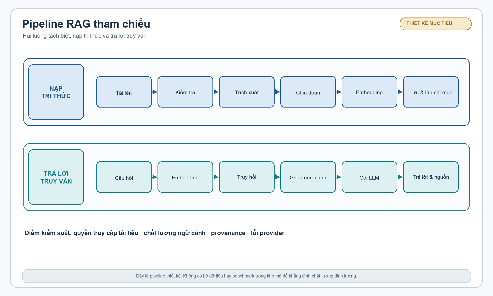
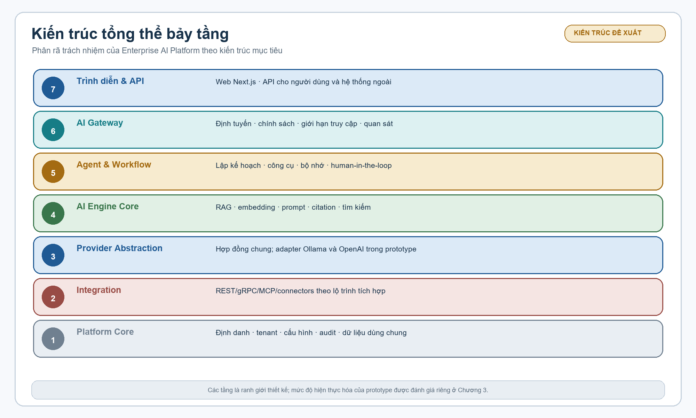
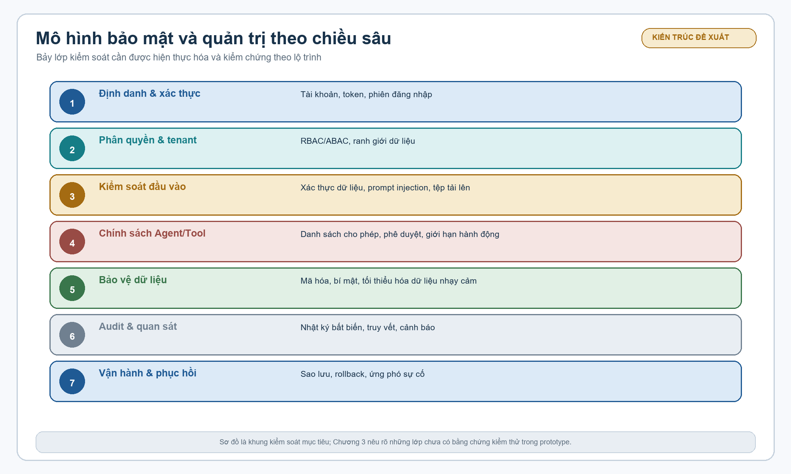

# SLIDE ĐỀ ÁN TỐT NGHIỆP THẠC SĨ KỸ THUẬT

## Nghiên cứu và xây dựng nền tảng AI doanh nghiệp hướng tích hợp đa hệ thống

**Học viên:** Nguyễn Tiến Đạt  
**Chuyên ngành:** Hệ thống Thông tin  
**Mã số:** 8.48.01.04  
**Người hướng dẫn:** PGS.TS. Trần Đình Quế  
**Hà Nội, 2026**

> Bản nội dung review cho deck 14 slide. Cấu trúc slide được giữ theo slide mẫu; nội dung được thay bằng đề tài Enterprise AI Platform.

---

# Slide 1. Trang bìa

## NGHIÊN CỨU VÀ XÂY DỰNG NỀN TẢNG AI DOANH NGHIỆP HƯỚNG TÍCH HỢP ĐA HỆ THỐNG

**ENTERPRISE AI PLATFORM FOR CROSS-SYSTEM INTEGRATION**

- Học viên: Nguyễn Tiến Đạt
- Chuyên ngành: Hệ thống Thông tin
- Mã số: 8.48.01.04
- Người hướng dẫn: PGS.TS. Trần Đình Quế
- Hà Nội, 2026

**Gợi ý hình ảnh:** hình nền tối, điểm nhấn là mạng kết nối giữa tài liệu, database, AI model và hệ thống doanh nghiệp. Không sử dụng ảnh minh họa có chữ nhỏ khó đọc.

**Thông điệp trình bày:** Đề tài xây dựng một nền tảng AI dùng chung, không chỉ là một chatbot đơn lẻ.

---

# Slide 2. I.1 MỞ ĐẦU | Lý do chọn đề tài

## Tri thức doanh nghiệp đang phân tán

- Tài liệu, cơ sở dữ liệu và API nghiệp vụ nằm ở nhiều hệ thống.
- Tìm kiếm từ khóa phụ thuộc vào thuật ngữ, cấu trúc thư mục và kinh nghiệm người dùng.
- LLM tạo câu trả lời tự nhiên nhưng có thể thiếu căn cứ hoặc vượt quyền truy cập.
- Mỗi ứng dụng tự tích hợp AI làm tăng phụ thuộc provider, chi phí và rủi ro quản trị.

### Nhu cầu

Một lớp AI dùng chung cần kết nối được tri thức nội bộ, provider, công cụ và chính sách bảo mật trong cùng một kiến trúc.

**Gợi ý bố cục:** bốn nguồn dữ liệu ở bên trái, nền tảng AI ở giữa, người dùng và ứng dụng ở bên phải.

---

# Slide 3. I.2 MỞ ĐẦU | Bài toán và khoảng trống

## Từ chatbot tài liệu đến nền tảng AI doanh nghiệp

### Bài toán cần giải quyết

1. Chuẩn hóa vòng đời tài liệu từ upload đến embedding.
2. Kết hợp tìm kiếm từ khóa và tìm kiếm ngữ nghĩa.
3. Sinh câu trả lời có context và citations.
4. Phân biệt trả lời thông tin với hành động gọi tool.
5. Kết nối nhiều provider và hệ thống ngoài qua boundary kiểm soát được.

### Khoảng trống

- RAG, agent, MCP và vector search thường được mô tả tách rời.
- Kiến trúc mục tiêu dễ bị nhầm với tính năng đã chạy.
- Chưa có cách thống nhất để đánh giá source skeleton, runtime và benchmark.

**Thông điệp trình bày:** Đề tài nghiên cứu cả kỹ thuật AI lẫn tính nhất quán kiến trúc và bằng chứng triển khai.

---

# Slide 4. I.3 MỞ ĐẦU | Mục đích nghiên cứu

## Mục tiêu của đề tài

### Mục tiêu tổng quát

Đề xuất kiến trúc và xây dựng prototype nền tảng AI doanh nghiệp hướng tích hợp đa hệ thống, hỗ trợ semantic search, RAG, agent, tool calling và MCP.

### Mục tiêu cụ thể

- Hệ thống hóa LLM, embedding, vector search, RAG, hybrid search, agent và MCP.
- Thiết kế kiến trúc bảy tầng, provider-agnostic và ưu tiên offline.
- Xây dựng vertical slice bằng .NET 8, Next.js, PostgreSQL/pgvector, Redis, MinIO, Ollama và Docker.
- Xây dựng protocol đánh giá retrieval, câu trả lời, citation, latency và security.
- Xác định rõ năng lực đã có, năng lực còn là skeleton và lộ trình hoàn thiện.

**Gợi ý hình ảnh:** mục tiêu ở trung tâm, năm nhánh: lý luận, kiến trúc, prototype, đánh giá, quản trị.

---

# Slide 5. I.4 MỞ ĐẦU | Đối tượng và phạm vi

## Phạm vi nghiên cứu

### Đối tượng

- Kiến trúc nền tảng AI doanh nghiệp.
- Pipeline tài liệu, embedding, vector search và RAG.
- Provider abstraction, AI Gateway, agent, tool và MCP.
- Identity, authorization, tenant isolation, audit và observability.

### Ba use case trọng tâm

1. Quản lý và lập chỉ mục tài liệu nội bộ.
2. Tìm kiếm ngữ nghĩa, hybrid search và hỏi đáp có trích dẫn.
3. Điều phối tác vụ và gọi công cụ read-only, có approval khi cần.

### Ngoài phạm vi giai đoạn này

Huấn luyện LLM mới, thay thế ERP/CRM/DMS, tích hợp production với hệ thống chưa có contract và công bố benchmark khi chưa có runtime evidence.

---

# Slide 6. I.5–I.6 MỞ ĐẦU | Phương pháp và ý nghĩa

## Phương pháp nghiên cứu

| Phương pháp | Cách sử dụng |
|---|---|
| Nghiên cứu tài liệu | Transformer, RAG, BM25, RRF, HNSW, ReAct, MCP, governance |
| Mô hình hóa | tác nhân, use case, pipeline, trust boundary, dữ liệu và API |
| Design science | xây dựng prototype theo vertical slice |
| Kiểm chứng source | đối chiếu tài liệu, code, DI, schema và Compose |
| Thực nghiệm | baseline retrieval, RAG, agent/tool và security cases |

### Ý nghĩa

- Tạo kiến trúc tham chiếu cho AI dùng chung trong doanh nghiệp.
- Ưu tiên dữ liệu nội bộ và triển khai local/offline.
- Đưa governance, audit và approval vào từ thiết kế.
- Phân biệt thiết kế, code skeleton, runtime và kết quả đo.

---

# Slide 7. CHƯƠNG 1 | Nền tảng lý luận và pipeline RAG

## RAG là một vòng đời, không chỉ là một prompt

### Ingestion

1. Validate file.
2. Lưu object và metadata.
3. Extract text.
4. Clean và normalize.
5. Chunk với overlap.
6. Embed.
7. Lưu vector và metadata.
8. Cập nhật trạng thái, log và thông báo.

### Query

1. Xác thực user và tenant.
2. Embed query.
3. Retrieve candidate.
4. Lọc quyền và rerank.
5. Lắp ghép context.
6. Sinh answer.
7. Kiểm tra citation.
8. Lưu history và metrics.

---

# Slide 8. CHƯƠNG 2 | Kiến trúc bảy tầng

## Kiến trúc nền tảng AI doanh nghiệp

| Tầng | Trách nhiệm |
|---:|---|
| 7. Presentation/API | REST, streaming, web UI, admin |
| 6. AI Gateway | routing, fallback, health, quota, cost |
| 5. Agent & Workflow | intent, planner, executor, memory, approval |
| 4. AI Engine Core | prompt, context, retrieval, rerank, response |
| 3. Provider Abstraction | LLM, embedding, speech, model capability |
| 2. Integration | connector, API adapter, event/message |
| 1. Platform Core | identity, tenant, policy, audit, cache, observability |

**Quyết định chính:** bắt đầu bằng modular monolith để kiểm chứng end-to-end, mở đường tách service khi tải và ownership tăng.

---

# Slide 9. CHƯƠNG 2 | Tích hợp, Agent, MCP và quản trị

## AI chỉ được hành động trong boundary được kiểm soát

### Provider và Gateway

- Ollama cho triển khai local.
- OpenAI provider theo cấu hình.
- Gateway xử lý routing, fallback, health và capability.

### Agent và tool

- Intent, plan, execute, observe và stop.
- Read-only knowledge có thể tự động hóa theo policy.
- SQL, API và side effect cần allowlist, giới hạn và approval.

### MCP

- Chuẩn hóa khám phá và gọi tool.
- Không thay thế authentication và authorization.
- Mỗi call cần principal, tenant, policy, schema, timeout và audit.

---

# Slide 10. CHƯƠNG 3 | Lộ trình hiện thực hóa theo năm phase

## Từ walking skeleton đến Enterprise Ready

| Phase | Nội dung chính | Cổng kiểm soát |
|---:|---|---|
| 1 | Foundation: auth, chat, session, Docker | build, login, chat, health |
| 2 | AI Engine & RAG: document, chunk, embedding, vector | ingest và trả lời có nguồn |
| 3 | Agent & Integration: tool, MCP, planner, approval | tool contract và security test |
| 4 | Advanced: hybrid, rerank, SQL, voice, memory, connector | benchmark và regression |
| 5 | Enterprise Ready: tenant, RBAC/OIDC/MFA, audit, DR | isolation, load, recovery |

### Nguyên tắc đóng phase

Một module xuất hiện trong source chưa đủ để đóng phase. Phase chỉ được coi là hoàn thành khi có build, runtime smoke test hoặc benchmark phù hợp.

---

# Slide 11. CHƯƠNG 4 | Giao thức đánh giá

## Đánh giá theo bốn nhóm bằng chứng

### Retrieval

Recall@k, Precision@k, MRR, nDCG@k và tỷ lệ query không có kết quả phù hợp.

### Answer

Faithfulness, answer relevance, citation precision/recall, correctness và refusal khi thiếu bằng chứng.

### Operation

p50/p95/p99, throughput, error rate, token, cost và cache hit.

### Safety

Tenant isolation, blocked action, approval correctness, SQL injection, prompt injection và audit completeness.

**Gợi ý bố cục:** bốn thẻ chỉ số, phía dưới là điều kiện “cùng corpus, cùng model, cùng config kiểm soát”.

---

# Slide 12. CHƯƠNG 4 | Ma trận đối chiếu thiết kế và prototype

## Trạng thái hiện tại cần đọc theo mức bằng chứng

| Mức | Ý nghĩa |
|---|---|
| E0 | mô tả trong tài liệu |
| E1 | có class, route, schema hoặc config trong source |
| E2 | liên kết được qua DI/build hoặc kiểm tra tĩnh |
| E3 | chạy local và có smoke test |
| E4 | benchmark lặp lại, có log và artifact |

### Một số trạng thái source

- Provider, RAG, search, agent, tool và MCP: có abstraction/skeleton, chủ yếu E1.
- Frontend: có pages/components, build cần xác minh.
- Docker: Compose parse được, runtime cần xác minh.
- Backend: chưa đạt E2 vì solution hiện chưa compile.
- Kết quả chất lượng và hiệu năng: chưa có E4.

**Thông điệp trình bày:** minh bạch mức sẵn sàng là một phần của kết quả nghiên cứu.

---

# Slide 13. CHƯƠNG 4–V | Rủi ro, trạng thái kiểm chứng và kế hoạch

## Các việc phải hoàn thành trước benchmark

### Rủi ro ưu tiên

- identifier AI Gateway làm backend không compile;
- hai DbContext/entity và hai hướng RAG cần hợp nhất;
- vector dimension 768 trong code và 1536 trong init schema;
- route health giữa Compose và Program không khớp;
- parser tài liệu, background scope, object key và tenant isolation cần kiểm tra;
- frontend chưa có dependency để chạy Next build.

### Kết quả kiểm tra hiện tại

| Kiểm tra | Trạng thái |
|---|---|
| `dotnet build` | Fail, 153 lỗi build |
| `npm run build` | Chưa chạy được, thiếu lệnh `next` trong môi trường hiện tại |
| `docker compose config` | Pass ở mức parse cấu hình |
| Runtime end-to-end | Chưa kiểm chứng |

### Kế hoạch gần nhất

Sửa build, hợp nhất schema và pipeline, hoàn thiện parser/worker, cài frontend dependency, bổ sung test, dựng corpus, chạy năm vòng benchmark.

---

# Slide 14. KẾT LUẬN | Đóng góp và hướng phát triển

## Nền tảng AI doanh nghiệp cần đồng thời có AI, tích hợp và quản trị

### Đóng góp dự kiến

- Cơ sở lý luận thống nhất cho LLM, RAG, hybrid search, agent và MCP.
- Kiến trúc bảy tầng provider-agnostic, ưu tiên local/offline.
- Prototype .NET/Next.js với PostgreSQL/pgvector, Redis, MinIO, Ollama và Docker.
- Mô hình vòng đời tài liệu, truy hồi, citations, tool call và audit.
- Thang bằng chứng E0–E4 và protocol thực nghiệm tái lập.

### Hướng phát triển

1. Đưa backend và frontend về trạng thái build được.
2. Chuẩn hóa DbContext, schema, vector dimension và configuration.
3. Hoàn thiện ingest, search, RAG citation và worker.
4. Kiểm thử agent, MCP, approval, tenant isolation và security.
5. Chạy benchmark và công bố kết quả kèm artifact.

**Lời kết:** Mục tiêu cuối cùng là một nền tảng AI có thể mở rộng, có căn cứ và có thể kiểm soát trong môi trường doanh nghiệp.
